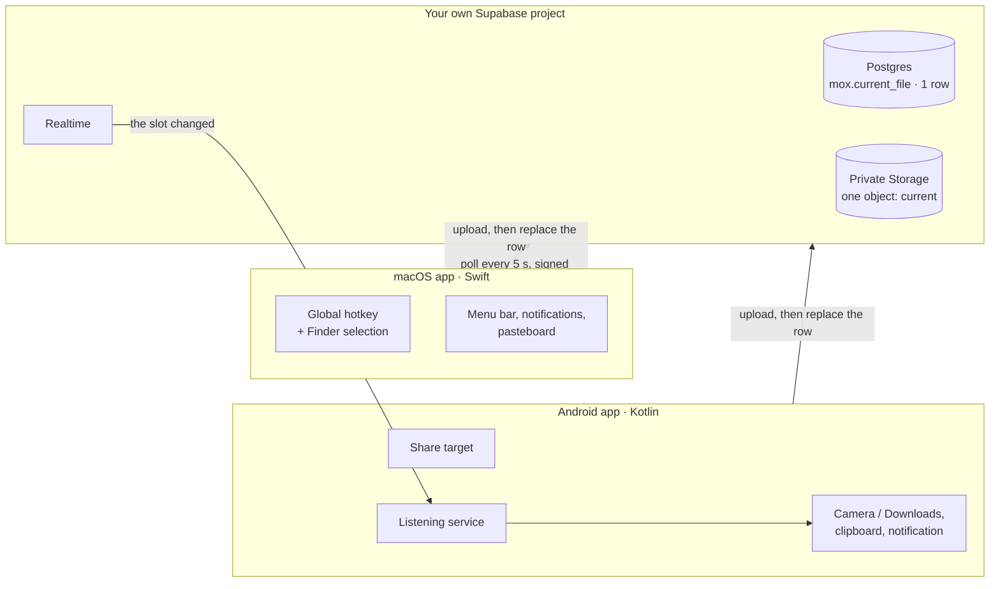

# Mox

**Send a file from your Mac to your Android phone, or back, with one action. It lands on the clipboard, ready to paste.**

[](https://github.com/GiamSoo23/Mox/actions/workflows/macos.yml)
[](https://github.com/GiamSoo23/Mox/actions/workflows/android.yml)
[](https://github.com/GiamSoo23/Mox/actions/workflows/backend.yml)
[](https://github.com/GiamSoo23/Mox/releases/latest)
[](LICENSE)

There's no AirDrop between a Mac and an Android phone. Mox fills that gap with
a native app on each side, connected through **your own** free Supabase
project. Mox has no servers and no accounts of its own, so your files never
pass through anyone else's infrastructure.

- **Mac → phone:** select a file in Finder and press **⌘⇧M**. Seconds later
  it's on the phone and on its clipboard, even with Mox closed.
- **Phone → Mac:** in any app, tap **Share → Mox**. The file lands in
  `~/Downloads` and on the clipboard, ready to `⌘V`.
- **Setup without copying keys:** sign in with Supabase on the Mac, then scan
  a QR code with the phone.

<!--
  DEMO: record a 15–30 s screen capture (Mac hotkey → phone notification → paste)
  and drag the .mp4/.gif into this README in GitHub's web editor. GitHub hosts it
  and inserts the link here.
-->

## Install

Follow the **[install guide](docs/INSTALL.md)**. It takes about ten minutes,
most of it waiting for Supabase to start a project. You need macOS 13+,
Android 8+ and a free Supabase account, which the setup window helps you create.

Downloads are on the [releases page](https://github.com/GiamSoo23/Mox/releases/latest).

## How it works



Supabase is the whole backend. A private Storage bucket holds the file, and a
single-row table describes it: name, size, type, which device sent it, and
when. Sending uploads the bytes **first** and replaces the row **second**, so
no device ever sees a row pointing at a file that isn't there yet.

Every client follows one written contract, [shared/PROTOCOL.md](shared/PROTOCOL.md),
and the Mac, Android, web and database test suites all run against the same
[shared fixtures](shared/fixtures/). More detail, including every state
machine, is in [docs/ARCHITECTURE.md](docs/ARCHITECTURE.md).

## Engineering highlights

| Problem | What Mox does | Where |
|---|---|---|
| **Set up a backend for someone who has never seen one** | The Mac signs in through OAuth with PKCE and a one-shot loopback listener, creates or reuses a project through the Management API, applies only the migrations it's missing, and creates a dedicated user. It stays safe to run again | [Provisioner.swift](desktop/macos/Sources/MoxCore/Provisioner.swift) |
| **Stay safe inside a project that also runs another app** | Everything lives in its own `mox` schema, and row level security admits exactly one generated user, so a leaked publishable key reads nothing | [migrations](backend/supabase/migrations/), [pgTAP tests](backend/supabase/tests/database/mox_v2_test.sql) |
| **Receive on Android with no push server** | Firebase would need a central sender, which Mox doesn't have. A foreground service holds one Realtime websocket instead, and treats an event only as "read the row again", so a lost event is recovered on reconnect | [ListeningService.kt](mobile/android/app/src/main/java/com/mox/app/ListeningService.kt) |
| **Hand credentials to a phone without typing** | The QR holds a link whose secrets are in the URL fragment, which browsers never send to a server. The Mac's QR window is excluded from screenshots and screen sharing | [PROTOCOL.md §8](shared/PROTOCOL.md#8-pairing-link-v1) |
| **Know when another device sent something** | Each installation has its own device id and remembers the last `uploaded_at` it handled, set by the database so devices never compare their own clocks | [FileReceiver.kt](mobile/android/app/src/main/java/com/mox/app/FileReceiver.kt) |
| **Stay reachable when macOS hides the menu bar icon** | Apps can't claim a place on a full menu bar, so opening Mox shows a window and a Dock icon | [HomeWindowController.swift](desktop/macos/Sources/Mox/HomeWindowController.swift) |

The bugs found along the way, each with its cause and fix, are in
[docs/BUGS.md](docs/BUGS.md). The reasoning behind the design, including the
alternatives that were rejected, is in [docs/DESIGN.md](docs/DESIGN.md).

## Tech stack

- **macOS:** Swift 5.9, AppKit and SwiftPM, with no third-party dependencies.
- **Android:** Kotlin, Jetpack Compose, coroutines and OkHttp. No Supabase SDK, so the APK stays small.
- **Backend:** Supabase (Postgres, PostgREST, Storage, Auth, Realtime), defined entirely in SQL migrations.
- **Pairing page:** plain HTML and JavaScript on GitHub Pages, with no third-party scripts.

## Testing and CI

Every pull request runs what applies to it:

| Area | Checks |
|---|---|
| **macOS** | SwiftLint in strict mode, build, 72 XCTest cases |
| **Android** | ktlint, 27 JUnit tests, APK build |
| **Database** | 30 pgTAP checks of the schema and of who can read and write what, on a real Postgres in Docker |
| **Pairing page** | 25 tests against the shared fixtures, then deploys to GitHub Pages |
| **Secrets** | gitleaks over the full git history |
| **Releases** | Signed APK, verified against the release key, and the Mac app, published with checksums from a version tag |

## Privacy and your data

Mox's author runs no backend and can't see anything you send.

- **Files and settings** stay in your own Supabase project and on your devices.
- **The current file stays in your project** until the next one replaces it. Mox keeps one file at a time.
- **Your Mox password** is kept in the macOS Keychain and in an Android Keystore-encrypted store.
- **The pairing page** reads its data in your browser. The page has no analytics and no third-party scripts.
- **No analytics or telemetry** in any app.

Supabase hosts your project under [its own terms](https://supabase.com/privacy).
If other people administer your Supabase organization, they could read your
files. The setup window warns you when that's the case.

See [SECURITY.md](SECURITY.md) for the security model and how to report a problem.

## Known limitations

- One file at a time, up to 50 MB, the Supabase free plan's limit. Sending several files is planned ([#19](https://github.com/GiamSoo23/Mox/issues/19), [#20](https://github.com/GiamSoo23/Mox/issues/20)).
- Files only, not plain text ([#101](https://github.com/GiamSoo23/Mox/issues/101)).
- Free Supabase projects pause after a week without use. Restore them from the dashboard.
- The Mac app isn't notarized by Apple, so macOS asks you to approve it once.
- No in-app updates yet ([#63](https://github.com/GiamSoo23/Mox/issues/63), [#64](https://github.com/GiamSoo23/Mox/issues/64)).
- Mac and Android only for now. iPhone and Windows are planned.

The plan, issue by issue, is in [docs/ROADMAP.md](docs/ROADMAP.md), and each
release is described in the [changelog](CHANGELOG.md).

## Build from source

1. **Mac:** `cd desktop/macos && ./build-app.sh && open Mox.app`. The setup
   window asks for a Supabase personal access token, because "Sign in with
   Supabase" needs the OAuth client secret that only official builds carry.
   See [desktop/macos/README.md](desktop/macos/README.md).
2. **Android:** `cd mobile/android && ./gradlew installDebug`, then pair with
   the Mac's QR code. See [mobile/android/README.md](mobile/android/README.md).
3. **Backend by hand** (optional): see [backend/README.md](backend/README.md).

## Repository layout

```
backend/          Supabase project: SQL migrations and pgTAP tests
desktop/macos/    Swift menu-bar app
  Sources/MoxCore/   logic with no UI: Supabase client, setup, pairing (unit-tested)
  Sources/Mox/       AppKit UI and macOS integrations
mobile/android/   Kotlin and Compose app
shared/           PROTOCOL.md and test fixtures every client must pass
web/              the pairing page, on GitHub Pages
docs/             install guide, architecture, design, roadmap, bug log
```

## Contributing

Issues and pull requests are welcome. Start with [CONTRIBUTING.md](CONTRIBUTING.md).

## License

[MIT](LICENSE)
