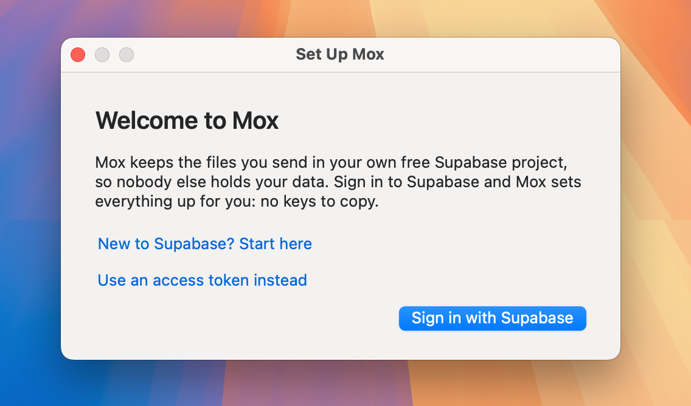
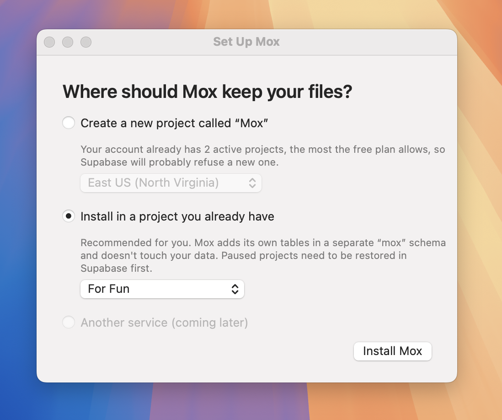
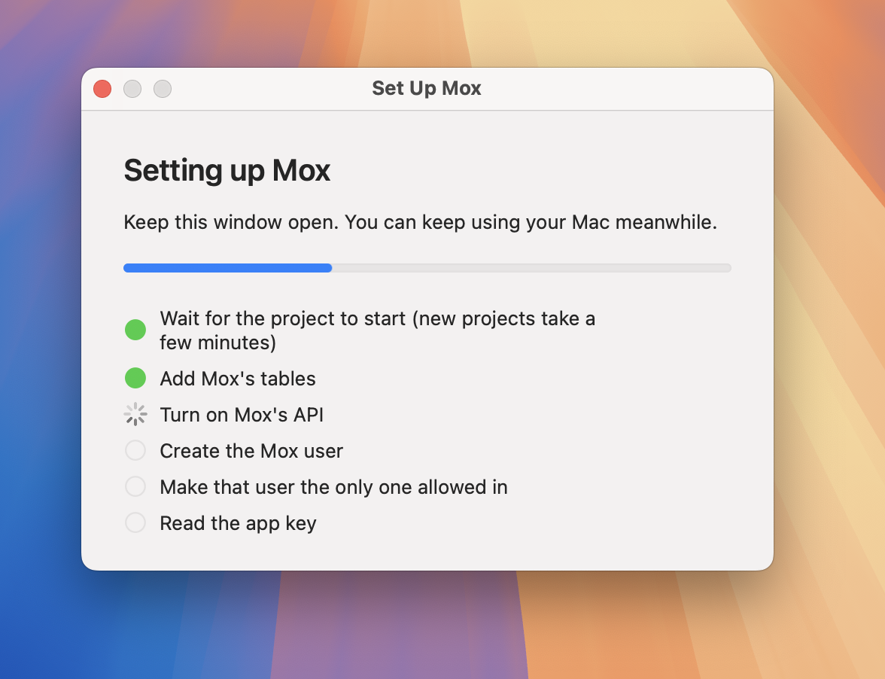
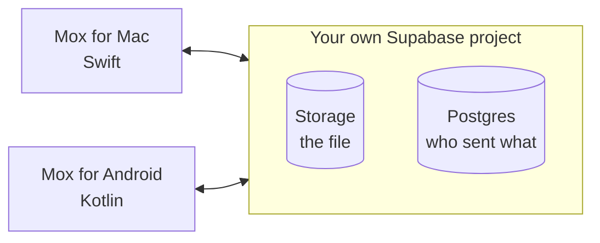
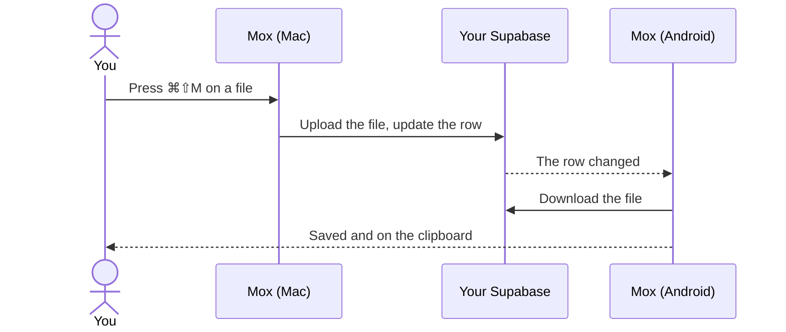

# Mox

<!-- DEMO VIDEO: drag the video file here in GitHub's web editor (10 MB at most). -->
https://github.com/user-attachments/assets/03f4bb3e-eb76-4dc7-8794-5c927f6aafd4

**Send a file between your Mac and your Android phone in one step. It lands on the clipboard, ready to paste.**

<!-- DEMO VIDEO: drag the video file here in GitHub's web editor (10 MB at most). -->

There's no AirDrop between a Mac and an Android phone, so Mox fills the gap:

- **Mac → phone:** select a file in Finder and press **⌘⇧M**. It arrives in seconds, even with Mox closed.
- **Phone → Mac:** in any app, tap **Share → Mox**. The file lands in `~/Downloads`.

Mox runs on **your own** free Supabase project. It has no servers and no
accounts of its own, so nobody else holds your files.

## Install

1. **Download** `Mox-macOS.zip` from the [latest release](https://github.com/GiamSoo23/Mox/releases/latest) and open the app.
2. **Sign in with Supabase** and choose where Mox keeps your files. Mox sets everything up.
3. **Scan the QR code** with your phone to install Mox there and pair it.

| Welcome | Choose a project | Automatic setup |
|---|---|---|
|  |  |  |

You need macOS 13+, Android 8+ and a free Supabase account. New to Supabase, or
macOS blocked the app? The **[install guide](docs/INSTALL.md)** walks through
every screen.

## How it works

Sending uploads the file, then updates one database row. The other device
hears that the row changed, downloads the file and copies it to the clipboard:

## Good to know

- One file at a time, up to 50 MB. Files only, not plain text.
- Free Supabase projects pause after a week without use. You can restore them from the dashboard.
- macOS asks you to approve the app once, because it isn't notarized by Apple.
- Mac and Android for now. iPhone and Windows are [planned](docs/ROADMAP.md).

## Learn more

| | |
|---|---|
| **[Install guide](docs/INSTALL.md)** | Every step with pictures, troubleshooting, uninstalling |
| **[Architecture](docs/ARCHITECTURE.md)** | Engineering highlights, tests, data model, each client |
| **[Security and privacy](SECURITY.md)** | Where your data lives and how it's protected |
| **[Design decisions](docs/DESIGN.md)** | Why it works this way, and what was rejected |
| **[Protocol](shared/PROTOCOL.md)** | The contract every client follows |
| **[Bug log](docs/BUGS.md)** · **[Changelog](CHANGELOG.md)** | What broke and why, and what changed in each version |
| **[Contributing](CONTRIBUTING.md)** | Building from source and running the tests |

Built with Swift, Kotlin and Supabase. [MIT license](LICENSE).
