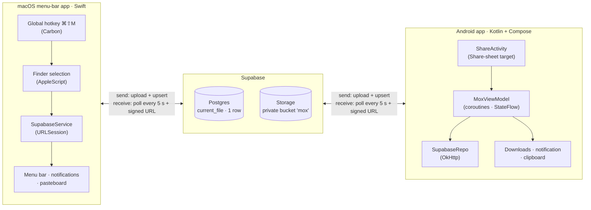
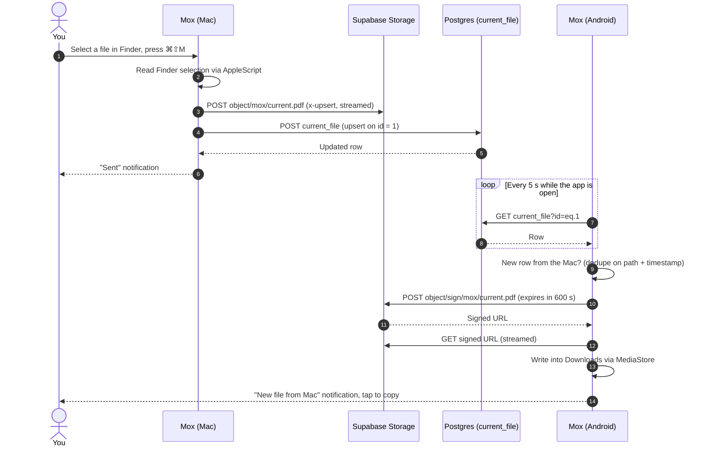

# Mox

**One file at a time, between your Mac and your Android phone.**

[](https://github.com/GiamSoo23/Mox/actions/workflows/macos.yml)
[](https://github.com/GiamSoo23/Mox/actions/workflows/android.yml)


There's no AirDrop between a Mac and an Android phone. Mox fills that gap for
the most common case — *"I just need this one file on my other device"*:

- **Mac → phone:** select a file in Finder, press **⌘⇧M**. A few seconds later
  it's in the phone's Downloads folder and one tap away from the clipboard.
- **Phone → Mac:** in any app (Gallery, WhatsApp, Chrome, Files…) tap
  **Share → Mox**. The file lands in `~/Downloads` on the Mac and is already
  on the clipboard, ready to `⌘V`.

It's a native app on each side — Swift/AppKit and Kotlin/Jetpack Compose —
that talk to each other through **your own** Supabase project. No custom
server, no third-party SDKs on either client. **Your files never pass through
anyone else's servers** (see [Privacy and your data](#privacy-and-your-data)).

<!--
  DEMO: record a 15–30 s screen capture (Mac hotkey → phone notification → paste)
  and drag the .mp4/.gif into this README in GitHub's web editor. GitHub hosts it
  and inserts the link here. Then add screenshots in a table, for example:

  | Mac menu bar | Android app | Share sheet |
  |---|---|---|
  |  |  |  |
-->

---

## Architecture



Supabase is the whole backend. The **Storage bucket** holds the file and a
**single-row Postgres table** (`current_file`) holds its metadata: name, size,
MIME type, which device sent it, and when. Each client *writes* by uploading
the file and upserting that row, and *reads* by polling the row and fetching
the file through a short-lived signed URL.

### What happens when you press ⌘⇧M



The phone → Mac direction is the same exchange with the roles swapped. More
diagrams (data model, Android UI states, per-client components and the full
HTTP surface) are in **[docs/ARCHITECTURE.md](docs/ARCHITECTURE.md)**.

---

## Tech stack

- **Mac client:** Swift 5.9, AppKit and SwiftPM, with **zero third-party
  dependencies**. A menu-bar-only app (`LSUIElement`) built on system APIs:
  Carbon `RegisterEventHotKey` for the hotkey, `NSAppleScript` for the Finder
  selection, `UserNotifications`, `SMAppService` for launch at login, and
  `NSPasteboard`.
- **Android client:** Kotlin, Jetpack Compose (Material 3), coroutines and
  `StateFlow`. Networking is OkHttp + `org.json` instead of the Supabase SDK,
  so the APK stays small. Uses share intents, `MediaStore`, `FileProvider` and
  notification channels. minSdk 26, targetSdk 35.
- **Backend:** Supabase (Postgres + PostgREST + Storage). The schema, RLS
  policies and bucket are defined in one idempotent
  [SQL migration](backend/supabase/migrations/20260526000000_initial_schema.sql).

---

## Design decisions

| Decision | Why | Trade-off |
|---|---|---|
| **Supabase as a dumb relay, no custom server** | Storage and a database behind one REST API, free tier, nothing to deploy or keep running. | Depends on a third-party service. |
| **Raw REST instead of the Supabase SDKs** | Both clients only need three calls: upload an object, upsert a row, sign a URL. Writing those by hand keeps the Mac app dependency-free and the APK small, and makes the two clients line up call for call. | Request code is hand-written, and Realtime isn't available without the SDK. |
| **"Only one file" is enforced by the database** | `current_file` has `id int primary key default 1` plus `CHECK (id = 1)`, so a second row can't exist. Clients upsert with `on_conflict=id` and `Prefer: resolution=merge-duplicates`. | No history. To send several files, zip them. |
| **Polling every 5 s instead of websockets** | Same simple loop on both platforms, survives network blips without reconnect logic, and is cheap for one row. | Up to ~5 s of latency and a steady trickle of small requests. |
| **Private bucket + signed URLs** | Files are never publicly addressable. Downloads use 10-minute URLs, and "Copy share link" makes a 1-hour one. | A share link is valid until it expires. |
| **Streaming uploads and downloads** | The Mac uses `URLSession.upload(fromFile:)`, and Android uses a custom OkHttp `RequestBody` that streams from the content URI. A large file never has to fit in memory. | — |

## Platform problems worth calling out

Most of the work wasn't the networking. It was fitting into what each OS allows:

1. **A global hotkey from a menu-bar app.** The Mac app registers its
   shortcut with Carbon's `RegisterEventHotKey`, so the system delivers that
   one key combination to Mox instead of Mox watching every keystroke. The
   default moved from ⌘⇧U to **⌘⇧M** because Finder's
   *Go → Utilities* takes ⌘⇧U whenever Finder is the frontmost app, which is
   exactly when you'd press it. ([HotKey.swift](desktop/macos/Sources/Mox/HotKey.swift))
2. **Reading what's selected in Finder.** There's no public API for it, so
   Mox runs a small AppleScript through `NSAppleScript`, with the Automation
   permission prompt explained in `Info.plist`.
   ([FinderSelection.swift](desktop/macos/Sources/Mox/FinderSelection.swift))
3. **Android 10+ won't let background apps write the clipboard** (and Samsung
   is strict about it). When a file arrives, Mox tries anyway. If that fails,
   tapping the notification opens a **transparent, single-frame activity**
   whose only job is to call `setPrimaryClip` while it's in the foreground.
   ([CopyToClipboardActivity.kt](mobile/android/app/src/main/java/com/mox/app/CopyToClipboardActivity.kt))
4. **Scoped storage.** On Android 10+ received files go into the public
   Downloads folder through `MediaStore` with `IS_PENDING`, so other apps
   never see a half-written file. Android 8–9 falls back to app storage
   behind a `FileProvider`.
   ([MoxViewModel.kt](mobile/android/app/src/main/java/com/mox/app/MoxViewModel.kt))
5. **No echo, no repeats.** Each client ignores rows it wrote itself
   (`uploaded_from`). Android saves the last file it handled
   (`storage_path|uploaded_at`) in `SharedPreferences`, so reopening the app
   doesn't download the same file again. The Mac doesn't notify on the first
   poll after launch.
6. **Pasting images on the Mac.** Received images go on the pasteboard as a
   file URL and as TIFF/PNG data, so `⌘V` works in Finder (copies the file)
   and in chat apps or rich-text editors (pastes the image).
   ([PasteboardCopier.swift](desktop/macos/Sources/Mox/PasteboardCopier.swift))
7. **Always running.** The Mac app adds itself as a Login Item once, on first
   launch, through `SMAppService`. If you turn that off later, it stays off.
   ([LoginItem.swift](desktop/macos/Sources/Mox/LoginItem.swift))

---

## Privacy and your data

**Mox has no servers.** Each person runs Mox on **their own** Supabase
project (a free one is enough), and their files go only between their own
devices and that project.

- **The maintainers never see, store or transmit your files**, or any other
  data of yours. There's no central account, database or relay.
- **You're responsible for your project and what you send through it**,
  including following [Supabase's terms](https://supabase.com/terms).
- What the project shares with everyone handles **no user data**:
  - **The code**, under the [MIT license](LICENSE), provided "as is",
    without warranty.
  - **The pairing page** on GitHub Pages: static files. The pairing details
    travel in the part of the link after `#`, which browsers never send to
    a server.
  - **The downloads** on GitHub Releases: the apps only, built in CI with no
    credentials inside. A downloaded Mox doesn't know any project until you
    pair it with yours.

## Security model

- **Your own project, your own keys.** Clients only ever hold the
  publishable key (`sb_publishable_…`), never the secret one, and it isn't
  in the source code: it comes from git-ignored local configuration today,
  and from the pairing QR in v2 ([#12](https://github.com/GiamSoo23/Mox/issues/12)). A key that was once
  committed has been rotated and returns `401` ([#36](https://github.com/GiamSoo23/Mox/issues/36)), and CI scans
  every PR for secrets ([#59](https://github.com/GiamSoo23/Mox/issues/59)).
- **Owner-only data (schema v2).** v2 doesn't trust the key alone: Row Level
  Security lets in exactly one dedicated Mox user, the owner, so the
  publishable key by itself reads nothing. That keeps Mox safe even inside a
  project that also runs a public website ([#40](https://github.com/GiamSoo23/Mox/issues/40)). Both apps speak
  v2, and the old anonymous v1 schema has been removed ([#49](https://github.com/GiamSoo23/Mox/issues/49)).
- **Private storage.** Files are only reachable through short-lived signed
  URLs, and the bucket is capped at 50 MB per file, the free plan's limit.
- **Tested.** pgTAP tests check who can read and write what, on every
  backend PR ([backend/README.md](backend/README.md#tests)).

## Known limitations and next steps

Each item is tracked as an issue:

- **Android only receives while the app is open.** Polling follows the
  activity lifecycle (`onStart` / `onStop`). Next step: WorkManager, or push.
  ([#37](https://github.com/GiamSoo23/Mox/issues/37))
- **The upload and the row update are two separate requests**, not one
  transaction. If the new file has a different extension, the old
  `current.<ext>` object stays in the bucket.
  ([#34](https://github.com/GiamSoo23/Mox/issues/34))
- **Uploads over 50 MB fail on the Supabase free plan**, even though the
  bucket allows 500 MB. ([#35](https://github.com/GiamSoo23/Mox/issues/35))
- **No automated tests yet.** First candidates are the pure functions:
  hotkey parsing, `.env` loading, file-name sanitising and size formatting.
  ([#10](https://github.com/GiamSoo23/Mox/issues/10),
  [#12](https://github.com/GiamSoo23/Mox/issues/12))
- **Credentials are compiled into the Android app**, and the app only
  supports one user. ([#36](https://github.com/GiamSoo23/Mox/issues/36))

Every bug found so far, with its cause and fix, is in
[docs/BUGS.md](docs/BUGS.md). What changed in each version is in
[CHANGELOG.md](CHANGELOG.md).

### Where it's going

Mox v2 turns this into an open-source, self-hosted tool: bring your own
Supabase project, pair a phone by scanning a QR code, send several files at
once, and later iPhone and Windows support. The design is in
[docs/DESIGN.md](docs/DESIGN.md) and the plan, issue by issue, is in
[docs/ROADMAP.md](docs/ROADMAP.md).

---

## Repository layout

```
mox/
├── backend/
│   └── supabase/             Supabase CLI project: config.toml + migrations/
├── desktop/
│   └── macos/                Swift menu-bar app (SwiftPM)
│       ├── Sources/Mox/
│       │   ├── AppDelegate.swift       wiring, polling loop, send flow
│       │   ├── MenuBarController.swift status item, menu, auto-save from phone
│       │   ├── SupabaseService.swift   REST client: Storage + PostgREST
│       │   ├── HotKey.swift            Carbon global hotkey + parser
│       │   ├── FinderSelection.swift   AppleScript bridge
│       │   ├── PasteboardCopier.swift  file + image clipboard
│       │   ├── LoginItem.swift         SMAppService wrapper
│       │   └── Config.swift            .env loader
│       └── build-app.sh        packages the binary into Mox.app
├── mobile/
│   └── android/              Kotlin app (Gradle)
│       └── app/src/main/java/com/mox/app/
│           ├── MainActivity.kt          Compose UI, lifecycle-bound polling
│           ├── ShareActivity.kt         Share-sheet target (ACTION_SEND)
│           ├── MoxViewModel.kt          UI state, auto-save, dedupe
│           ├── SupabaseRepo.kt          REST client: Storage + PostgREST
│           ├── MoxNotifications.kt      channel + "file arrived" notification
│           └── CopyToClipboardActivity.kt  foreground trampoline for clipboard
└── docs/
    ├── ARCHITECTURE.md       deeper diagrams and the HTTP surface
    ├── BUGS.md               bug log: causes, fixes, lessons
    ├── DESIGN.md             v2 design decisions
    └── ROADMAP.md            the plan, issue by issue
```

## Running it yourself

**To use Mox,** follow [docs/INSTALL.md](docs/INSTALL.md): download the Mac
app, sign in with Supabase in the setup window, and scan the QR code with
your phone. Mox creates or prepares your Supabase project for you.

**To build it from source:**

1. **Mac:** `cd desktop/macos && ./build-app.sh && open Mox.app`. The setup
   window asks for a Supabase personal access token, because "Sign in with
   Supabase" needs the OAuth client secret that only official builds carry
   (set `MOX_OAUTH_CLIENT_SECRET` if you registered your own OAuth app). See
   [desktop/macos/README.md](desktop/macos/README.md).
2. **Android:** `cd mobile/android && ./gradlew installDebug`, then choose
   **Pair a Phone…** on the Mac and scan the QR code. See
   [mobile/android/README.md](mobile/android/README.md).
3. **Backend by hand** (optional, instead of the setup window): see
   [backend/README.md](backend/README.md).
