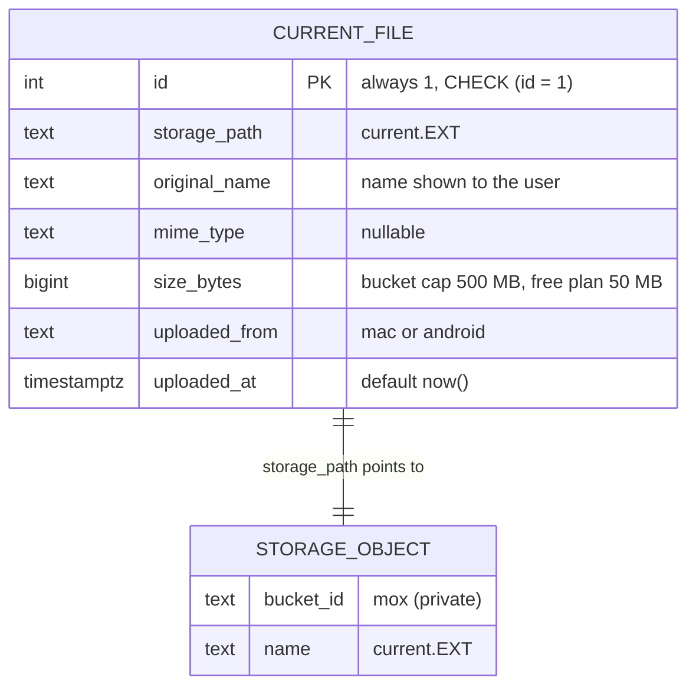
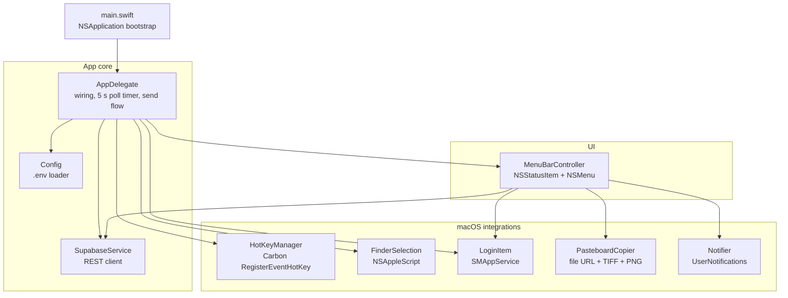
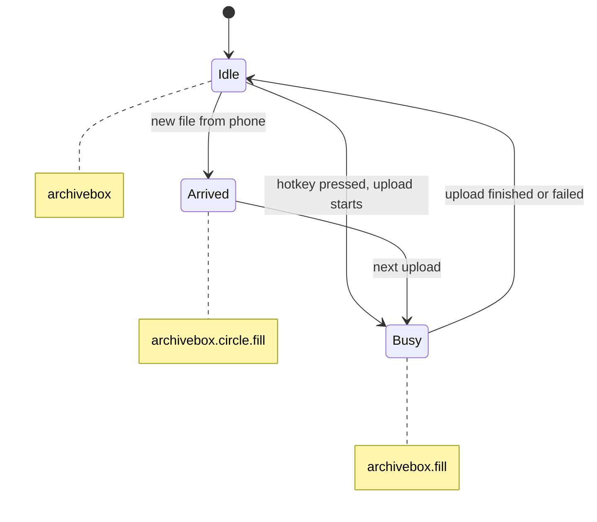
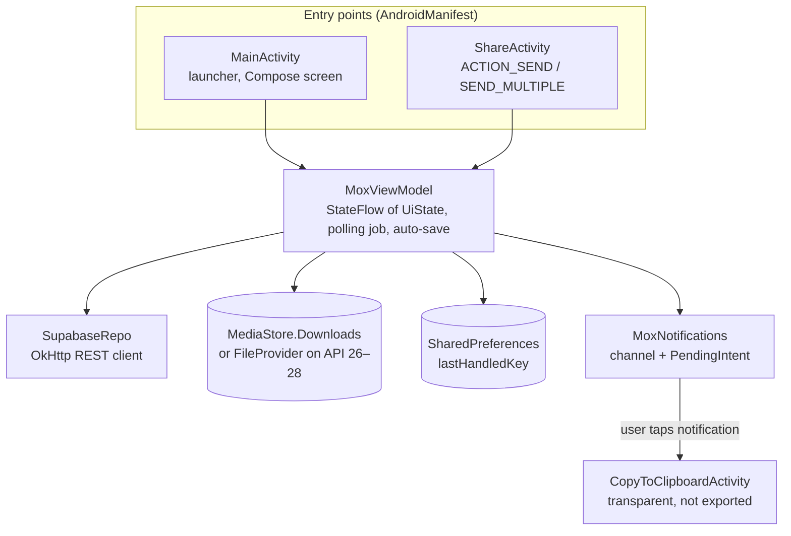
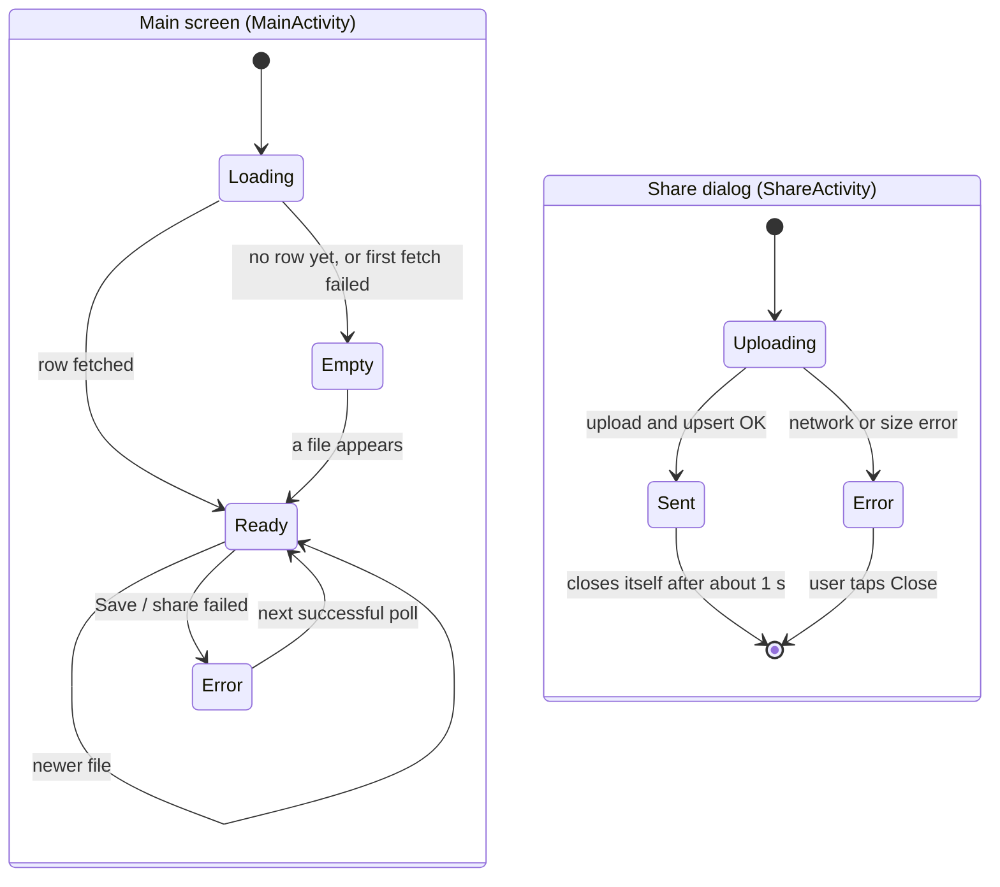
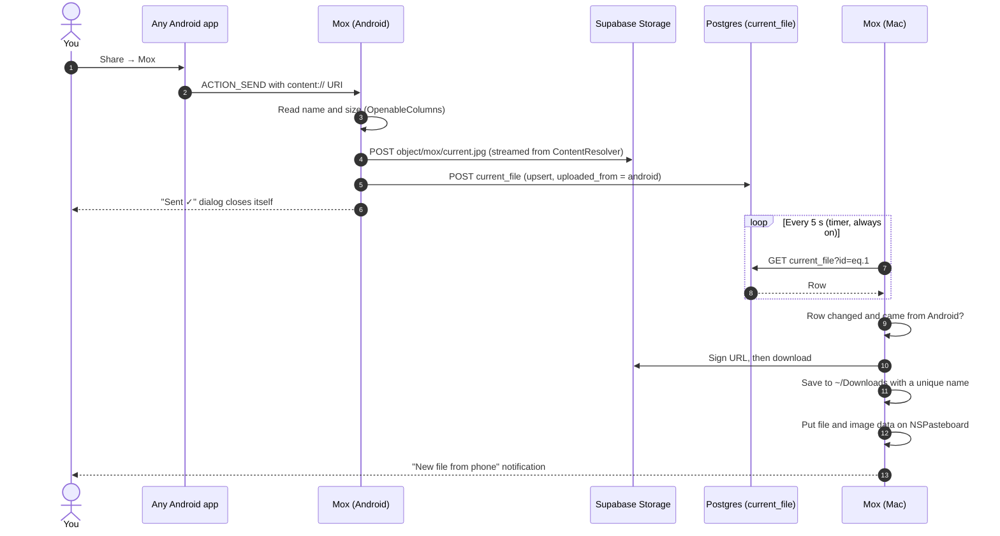

# Mox: architecture

This document goes one level below the [README](../README.md): how the data
is stored, how each client is put together, every HTTP call they make, and
the state machines behind the UI.

- [Data model](#data-model)
- [HTTP surface](#http-surface)
- [Mac client](#mac-client)
- [Android client](#android-client)
- [Phone → Mac flow](#phone--mac-flow)
- [Polling and deduplication](#polling-and-deduplication)
- [Concurrency](#concurrency)

---

## Data model

The backend is defined entirely in [backend/schema.sql](../backend/schema.sql).
The script is idempotent, so it's safe to run again.

- **The singleton is enforced by the database, not by convention.** The
  primary key defaults to `1` and a `CHECK (id = 1)` constraint rejects
  anything else, so there can never be a second current file.
- **`uploaded_from`** is limited to `'mac'` or `'android'` by a `CHECK`
  constraint. Clients use it to skip their own uploads.
- **`uploaded_at`** is set by Postgres (`default now()`), so both devices
  compare the same clock instead of trusting their own.
- **Row Level Security** is on for the table, and `storage.objects` has
  policies scoped to `bucket_id = 'mox'`. Both grant the `anon` role full CRUD
  (see the security model in the README).

## HTTP surface

Both clients call these endpoints directly. There's no SDK, so this table is
the whole contract between the apps and the backend.

| # | Purpose | Method and path | Notable headers / body | Mac | Android |
|---|---|---|---|:-:|:-:|
| 1 | Read the current file | `GET /rest/v1/current_file?id=eq.1&select=*` | — | ✓ | ✓ |
| 2 | Upload the file bytes | `POST /storage/v1/object/mox/current.<ext>` | `x-upsert: true`, streamed body | ✓ | ✓ |
| 3 | Point the row at it | `POST /rest/v1/current_file?on_conflict=id` | `Prefer: resolution=merge-duplicates,return=representation` | ✓ | ✓ |
| 4 | Get a download link | `POST /storage/v1/object/sign/mox/current.<ext>` | `{"expiresIn": 600}` (3600 for share links) | ✓ | ✓ |
| 5 | Download | `GET /storage/v1/object/sign/...?token=…` | signed URL, no auth header needed | ✓ | ✓ |

Every authenticated request sends the key both as `apikey` and as
`Authorization: Bearer …`. Sending a file is always **2 → 3** in that order,
so the row never points at bytes that haven't finished uploading. Receiving
is **1 → 4 → 5**.

Implementations:
[SupabaseService.swift](../desktop/macos/Sources/Mox/SupabaseService.swift) ·
[SupabaseRepo.kt](../mobile/android/app/src/main/java/com/mox/app/SupabaseRepo.kt)

---

## Mac client

A SwiftPM executable packaged into `Mox.app` by
[build-app.sh](../desktop/macos/build-app.sh). `LSUIElement` keeps it out of the Dock.
It has no third-party dependencies.

**Configuration.** `Config` merges the process environment with the first
`.env` it finds, in this order: `$MOX_ENV`, `~/.config/mox/.env`, the current
directory, the app bundle's `Resources/`, then the folder next to the binary.
Keys: `SUPABASE_URL`, `SUPABASE_ANON_KEY`, plus optional `MOX_HOTKEY` (for
example `cmd+shift+m`) and `MOX_POLL_SECONDS`.

**Send flow.** Hotkey or menu item → `FinderSelection.current()` → reject
folders and empty selections → `uploadFile` (calls 2 and 3) → refresh the
menu and post a notification.

**Receive flow.** On every poll, `MenuBarController.update` compares the row
with the last one it saw. If the row changed, came from Android, and this
isn't the first poll since launch, it downloads the file to `~/Downloads`
(as `name (1).ext`, `name (2).ext`… if the name is taken), puts it on the
pasteboard, and posts a notification.

**Menu-bar icon states:**

---

## Android client

A single-module Compose app. Dependencies: AndroidX, Compose Material 3,
OkHttp, kotlinx-coroutines.

**Screen states.** Both activities render the same sealed `UiState`, which
they collect from their own `MoxViewModel` instance. The main screen polls
and receives files, and the share dialog sends them:

After the first successful load, a failed poll doesn't change the screen.
The last good state stays up, so a dropped connection doesn't flash an error.

**Share target.** `ShareActivity` takes the first stream from `ACTION_SEND`
(or from `ACTION_SEND_MULTIPLE`, because Mox is single-file), reads the
display name and size through `OpenableColumns`, shows a small Compose
dialog while uploading, and closes itself about 1 s after "Sent ✓".

**Clipboard trampoline.** Android 10+ ignores `setPrimaryClip` from apps in
the background. The notification's `PendingIntent` therefore opens
`CopyToClipboardActivity`: it has no UI, is excluded from recents, has
`noHistory`, sets the clip, shows a toast and finishes in the same frame.

---

## Phone → Mac flow

---

## Polling and deduplication

Both clients poll the same row, but they make different choices about when
to act on it:

| | Mac | Android |
|---|---|---|
| When it polls | Always: a `Timer` started at launch | Only while `MainActivity` is visible (`onStart` → `onStop`) |
| Interval | `MOX_POLL_SECONDS`, default 5 s | `Config.POLL_MS`, 5 s |
| "Is this new?" | In memory: row ≠ last row seen | Persisted: `storage_path\|uploaded_at` ≠ `lastHandledKey` |
| Skips own uploads | `uploaded_from != "mac"` | `uploaded_from != "android"` |
| On first poll after launch | Updates the menu, no download or notification | Downloads if the key is new (the key survives restarts) |
| On network error | Ignored silently | Keeps the last good state |

## Concurrency

- **Mac:** `async/await` on `URLSession`. Network calls run in `Task`s, UI
  updates go back through `MainActor.run`, and the Carbon hotkey callback
  hops to the main queue before it does anything.
- **Android:** `viewModelScope` coroutines. All I/O in `SupabaseRepo` runs on
  `Dispatchers.IO`, the clipboard write runs on `Dispatchers.Main`, and the UI
  watches a `StateFlow` with `collectAsState()`. The polling `Job` is cancelled
  in `onStop`, so nothing polls in the background.
