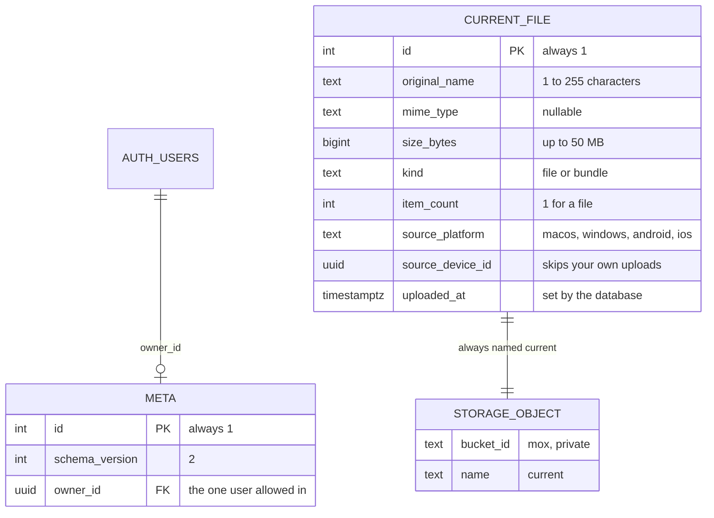
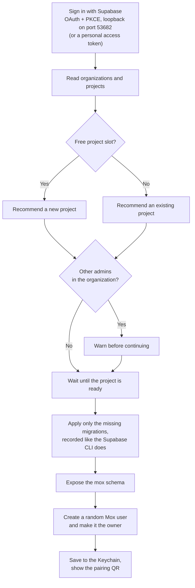
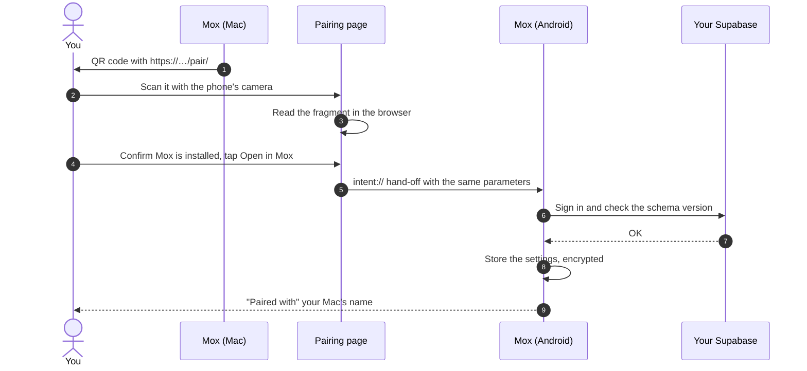
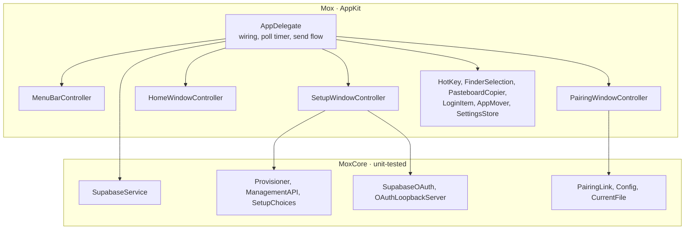
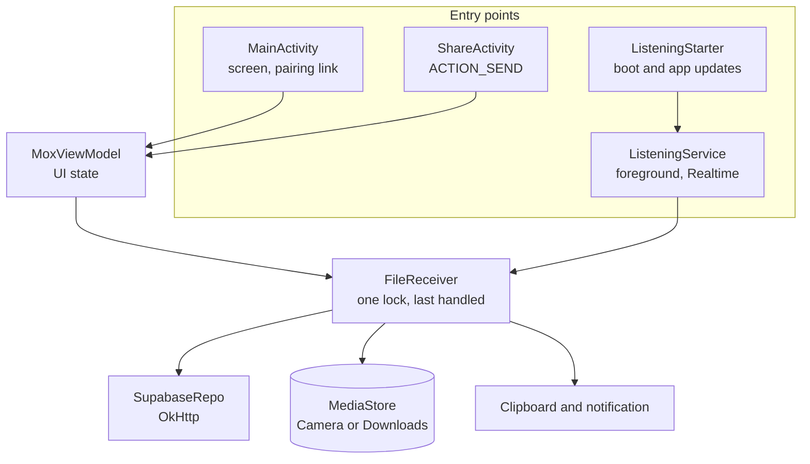
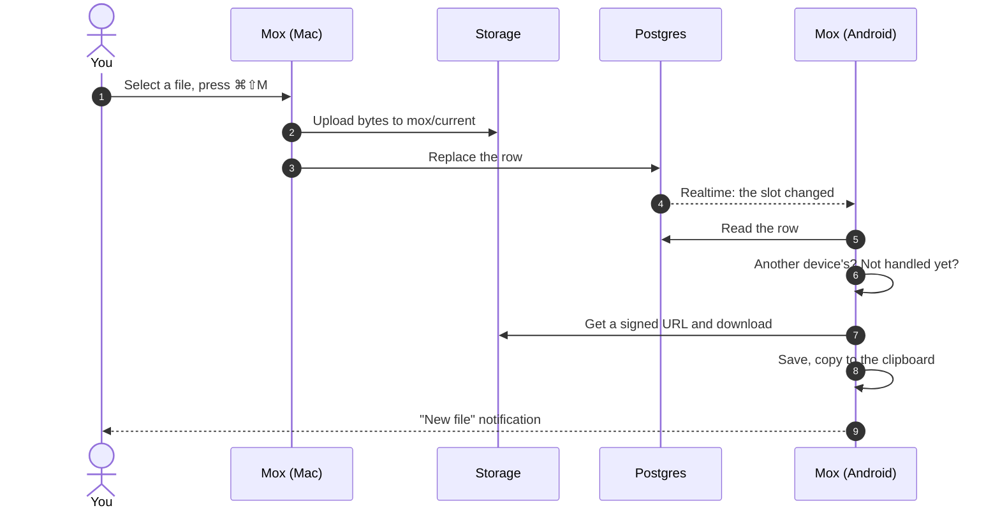
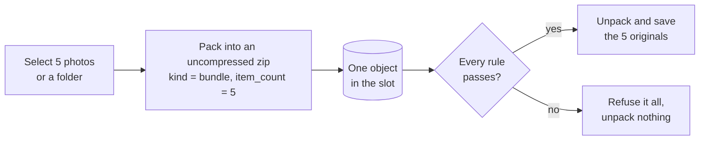

# Mox: architecture

This document goes one level below the [README](../README.md): how data is
stored, how each client is built, and how the main flows work. The contract
between clients is [shared/PROTOCOL.md](../shared/PROTOCOL.md). The reasoning
behind these choices is in [DESIGN.md](DESIGN.md).

- [Engineering highlights](#engineering-highlights)
- [Testing and CI](#testing-and-ci)
- [Data model](#data-model)
- [Setting up a project](#setting-up-a-project)
- [Pairing a phone](#pairing-a-phone)
- [Mac client](#mac-client)
- [Android client](#android-client)
- [Windows client](#windows-client)
- [iPhone client](#iphone-client)
- [Sending and receiving](#sending-and-receiving)
- [Concurrency](#concurrency)

---

## Engineering highlights

| Problem | What Mox does | Where |
|---|---|---|
| **Set up a backend for someone who has never seen one** | The Mac signs in through OAuth with PKCE and a one-shot loopback listener, creates or reuses a project through the Management API, applies only the migrations it's missing, and creates a dedicated user. It stays safe to run again | [Provisioner.swift](../desktop/macos/Sources/MoxCore/Provisioner.swift) |
| **Stay safe inside a project that also runs another app** | Everything lives in its own `mox` schema, and row level security admits exactly one generated user, so a leaked publishable key reads nothing | [migrations](../backend/supabase/migrations/), [pgTAP tests](../backend/supabase/tests/database/mox_v2_test.sql) |
| **Receive on Android with no push server** | Firebase would need a central sender, which Mox doesn't have. A foreground service holds one Realtime websocket instead, and treats an event only as "read the row again", so a lost event is recovered on reconnect | [ListeningService.kt](../mobile/android/app/src/main/java/com/mox/app/ListeningService.kt) |
| **Hand credentials to a phone without typing** | The QR holds a link whose secrets are in the URL fragment, which browsers never send to a server. The Mac's QR window is excluded from screenshots and screen sharing | [PROTOCOL.md §8](../shared/PROTOCOL.md#8-pairing-link-v1) |
| **Send several files through a one-file slot** | They travel as one uncompressed zip, so the slot still holds a single object. Every app reads it with the same defensive rules (no `..`, links or drive letters, caps on entries and size), checked against shared fixtures. The Mac, Android and iPhone parse the zip themselves, with no libraries, because standard readers hide whether an entry is a link | [PROTOCOL.md §9](../shared/PROTOCOL.md#9-bundle-format-v1), [BundleReader.swift](../desktop/macos/Sources/MoxCore/BundleReader.swift) |
| **Know when another device sent something** | Each installation has its own device id and remembers the last `uploaded_at` it handled, set by the database so devices never compare their own clocks | [FileReceiver.kt](../mobile/android/app/src/main/java/com/mox/app/FileReceiver.kt) |
| **Stay reachable when macOS hides the menu bar icon** | Apps can't claim a place on a full menu bar, so opening Mox shows a window and a Dock icon | [HomeWindowController.swift](../desktop/macos/Sources/Mox/HomeWindowController.swift) |

The bugs found along the way, each with its cause and fix, are in
[docs/BUGS.md](BUGS.md). The reasoning behind the design, including the
alternatives that were rejected, is in [docs/DESIGN.md](DESIGN.md).

## Testing and CI

Every pull request runs what applies to it:

| Area | Checks |
|---|---|
| **macOS** | SwiftLint in strict mode, build, 87 XCTest cases |
| **Windows** | .NET analyzers with warnings as errors, build for x64 and ARM, 26 xUnit tests |
| **Android** | ktlint, 35 JUnit tests, APK build |
| **Pairing page and iPhone** | Typecheck, 53 tests against the shared fixtures, build, then deploys to GitHub Pages |
| **Database** | 40 pgTAP checks of the schema and of who can read and write what, on a real Postgres in Docker, plus every row fixture inserted against the real constraints |
| **Contract** | Mox for iPhone's real client against a local Supabase: upload, read, sign and download a file, a text and a bundle, and checks that nobody else gets in |
| **Edge Functions** | `deno fmt`, `deno check` and Deno tests for `mox-push` and `mox-send` |
| **Shared fixtures** | The bundle fixtures are rebuilt and checked against a reference reader |
| **Secrets** | gitleaks over the full git history, plus a check that the OAuth client secret never appears |
| **Releases** | Signed APK verified against the release key, the Mac app and the Windows exes for x64 and ARM, published with checksums from a version tag |

---

## Data model

The backend is defined entirely in SQL migrations under
[backend/supabase/migrations/](../backend/supabase/migrations/). Everything
Mox owns lives in a `mox` schema, so it can share a project with another app
without touching its tables.

- **One slot, enforced by the database.** `CHECK (id = 1)` makes a second row impossible.
- **One owner.** Row level security on both tables and on the bucket compares `auth.uid()` with `mox.owner_id()`. The `anon` role gets nothing, so the publishable key alone reads nothing.
- **`uploaded_at` comes from the database**, through a trigger that also fires on upserts, so devices never compare their own clocks.
- **Realtime.** `mox.current_file` is in the `supabase_realtime` publication, and Realtime applies the same row level security.

## Setting up a project

The setup window drives [Provisioner.swift](../desktop/macos/Sources/MoxCore/Provisioner.swift).
Each step checks what's already there, so running it again is safe.

The Supabase token stays in memory. The project's secret key is read once to
create the Mox user and then dropped. The migrations are compiled into the app
by [sync-migrations.py](../desktop/macos/scripts/sync-migrations.py), because
`Mox.app` is assembled from the binary alone, and a test keeps that copy equal
to `backend/`.

## Pairing a phone

The parameters stay in the URL **fragment**, which browsers never send to a
server. If Mox isn't installed, the hand-off returns to the page, which asks
to install it first.

## Mac client

A SwiftPM package with two targets. `MoxCore` holds everything that doesn't
need a screen and is what the tests cover. `Mox` is the AppKit app, with
`LSUIElement` set so it lives in the menu bar. There are no third-party
dependencies.

- **Settings** live in the login Keychain. A complete `.env` is a developer override.
- **Hotkey:** Carbon's `RegisterEventHotKey`, so Mox receives one key combination instead of watching the keyboard. The default is ⌘⇧M because Finder takes ⌘⇧U.
- **Finder selection:** there's no public API, so Mox runs a short AppleScript.
- **Pasteboard:** received images go on as a file URL and as TIFF and PNG, so `⌘V` works in Finder and in chat apps.
- **Reaching Mox:** macOS hides menu bar icons when the bar is full. Opening Mox shows a window and a Dock icon.

## Android client

A single-module Compose app. Its dependencies are AndroidX, Compose Material 3,
OkHttp and coroutines.

- **Receiving with the app closed:** a `specialUse` foreground service holds one Realtime websocket and restarts after a reboot or an update. Firebase push isn't used because it needs a central sender.
- **An event means only "the slot changed".** The service reads the row again on every event, on every reconnection and every five minutes, so a lost event costs a delay and not a file.
- **Token expiry:** the connection is renewed shortly before the access token expires.
- **One receiver:** the screen and the service share `FileReceiver`, whose lock keeps a file from being received twice.
- **Saving:** photos and videos go to the Camera folder, the rest to Downloads, through `MediaStore` with `IS_PENDING` so other apps never see a half-written file.
- **Clipboard:** written from the background on the phones tested. Where that's refused, tapping the notification opens a transparent activity that writes it.

## Windows client

A .NET 8 app in the notification area, published as one self-contained exe
for x64 and ARM. `Mox.Core` holds the logic with no UI, tested with xUnit;
`Mox.Tray` holds the WinForms UI.

- **Setup:** the same flow as the Mac, ported: OAuth with PKCE through a loopback listener on 127.0.0.1 and ::1, the Management API, the migrations and functions embedded from `backend/`, and a progress bar.
- **Settings:** in `%APPDATA%\Mox`, encrypted with DPAPI for the current Windows user.
- **Sending:** `RegisterHotKey` for Ctrl+Shift+M. It reads the Explorer selection through the `Shell.Application` COM object, or else the clipboard (files, an image or text).
- **Receiving:** polls every 5 seconds, saves to Downloads and puts the file, or every file of a bundle, on the clipboard.
- **One copy, at login:** a new copy quits older ones, and a `HKCU\…\Run` value starts it with Windows.

## iPhone client

A home screen web app, served from GitHub Pages, in TypeScript with no
framework. iOS doesn't let a web app run in the background, so it relies on
two system features instead:

- **Web Push, from the user's own project.** A database trigger calls the `mox-push` Edge Function through `pg_net`, which signs a notification with VAPID keys the setup window created. The notification says only what arrived, never the content.
- **A shortcut in the Share menu.** "Send to Mox" posts the shared file to the `mox-send` Edge Function, which signs in as the Mox user with the credentials the shortcut holds and writes bytes, then row.
- **Receiving:** tapping the notification opens Mox, which copies texts and images (`ClipboardItem` with a promise, the only way Safari allows after an `await`), and offers the share sheet for everything else. A bundle opens the share sheet with every file.
- **Pairing:** the QR opens the pairing page, which copies a pairing code; the app reads it from the clipboard after it's added to the home screen, because iOS gives the home screen app its own storage.

## Sending and receiving

Phone → Mac is the same exchange in the other direction, except that the Mac
polls every 5 seconds instead of holding a connection.

| | Mac | Android |
|---|---|---|
| **Hears about changes** | Polls every 5 s (`MOX_POLL_SECONDS`) | Realtime, plus a 5 s poll while the screen is open |
| **Is it new?** | `uploaded_at` ≠ the last handled, kept in UserDefaults | The same, kept in SharedPreferences |
| **Skips its own uploads** | `source_device_id` | `source_device_id` |
| **First read after pairing** | Records the slot, downloads nothing | Records the slot, downloads nothing |
| **Network error** | Ignored, retried on the next poll | Keeps the last state, reconnects with backoff |

### Several files at once

One file is always sent as is, even a `.zip`. Several files, or a folder,
become a **bundle**: an uncompressed zip, because photos and videos are
already compressed. The row says `kind = bundle` and how many files it has.
The sender checks the 50 MB limit before packing and names the biggest files
when it's over.

Before writing anything, the receiver checks every entry: no absolute paths,
drive letters, backslashes or `..`, no symbolic links, at most 1000 entries
and 50 MB unpacked, and at least 2 files. One bad entry refuses the whole
bundle. The rules and their fixtures are in
[PROTOCOL.md §9](../shared/PROTOCOL.md#9-bundle-format-v1), and every app
(Mac, Windows, Android, iPhone) is tested against the same files.

| | Mac | Windows | Android | iPhone |
|---|---|---|---|---|
| **Sends** | The whole Finder selection | The whole Explorer selection, or copied files | Share several items | One item (Shortcuts) |
| **Unpacks into** | `Downloads/Mox – 5 files – 14.32/` | The same in Downloads | Gallery or Downloads, by type | The share sheet, with every file |
| **Zip reader** | Its own, with Compression | System.IO.Compression | Its own, with Inflater | Its own, with DecompressionStream |

## Concurrency

- **Mac:** `async/await` on `URLSession`. Network work runs in `Task`s, UI updates return to the main actor, and the Carbon hotkey callback hops to the main queue.
- **Windows:** `async/await` on `HttpClient` from the WinForms UI thread, with a flag so a poll never overlaps another or a send.
- **iPhone:** one page and a service worker; the service worker keeps the last notification tap so the page can act on it when it opens.
- **Android:** `viewModelScope` for the screen and a service-owned scope for listening. I/O runs on `Dispatchers.IO`, the clipboard on `Dispatchers.Main`, and a process-wide `Mutex` guards receiving.
