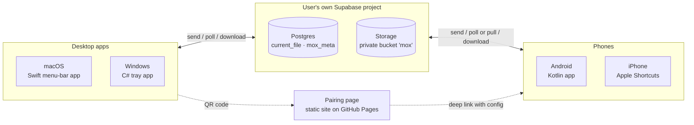
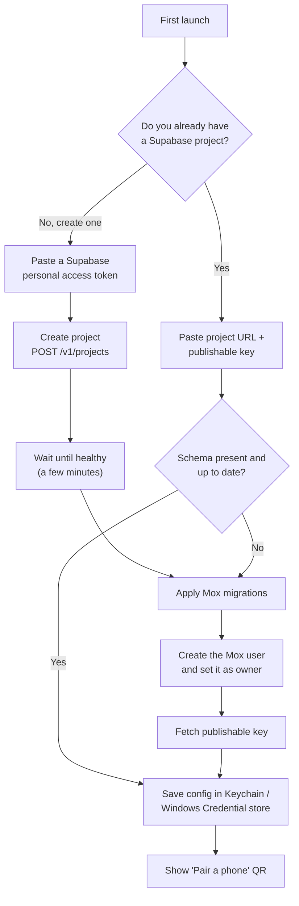
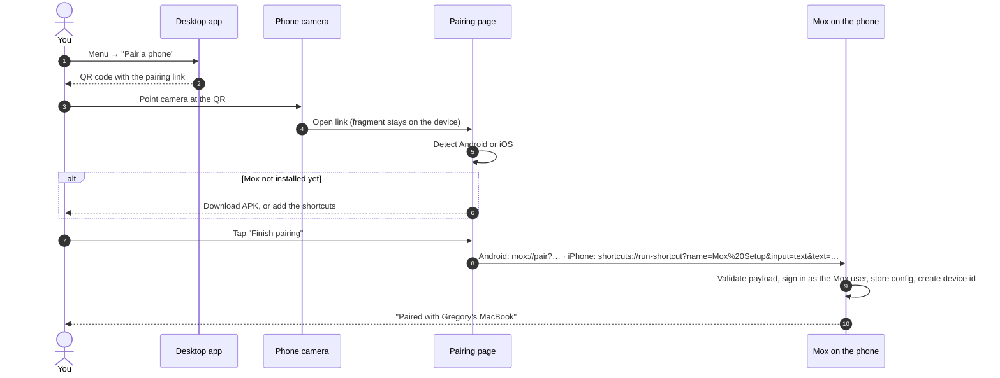
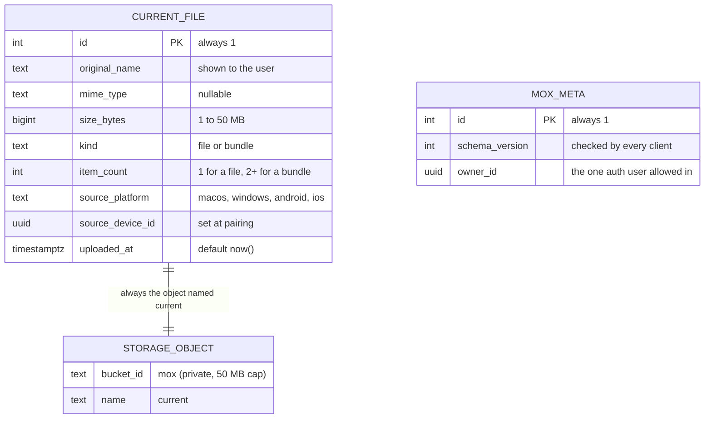
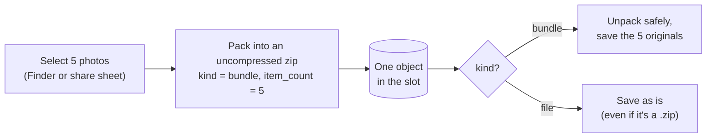

# Mox v2: design

**Status:** draft · **Last updated:** 2026-11-07 · **Plan:** [ROADMAP.md](ROADMAP.md)

Mox v1 is a personal tool. One Mac and one Samsung phone share a Supabase
project whose credentials are compiled into both apps. v2 turns it into an
**open-source, self-hosted relay**. Anyone can pair **any desktop (macOS or
Windows) with any phone (Android or iPhone)** through their own free Supabase
project, using the same downloadable binaries, with no recompiling and no paid
developer accounts.

**Delivery order:** Mac ↔ Android first (v1.0), because that pair already
exists. Then iPhone (v1.1), then Windows (v1.2). See [ROADMAP.md](ROADMAP.md).

---

## 1. Why v2

| Trigger | Consequence |
|---|---|
| The author switched from Android to iPhone. | The v1 pair (Mac ↔ Android) no longer covers their own use. The tool only stays useful if it is general. |
| Credentials are compiled into the Android app. | Nobody else can use a prebuilt APK, and the key sits in git history. |
| Supabase retires the legacy `anon` / `service_role` keys at the end of 2026. | Clients must move to publishable keys (`sb_publishable_…`). |
| The Supabase free plan caps uploads at 50 MB per file. | The 500 MB limit in v1 is wrong for free projects and has to change. |

## 2. Goals and non-goals

**Goals**

- Every desktop can pair with every phone: macOS or Windows ↔ Android or iPhone.
- **Bring your own backend:** each user owns a free Supabase project. Mox
  runs no servers.
- **Same binaries for everyone.** Configuration happens at runtime, never at
  build time.
- **Pairing by QR:** the desktop shows a code, the phone scans it, done.
- **Free to distribute:** GitHub Releases, no Apple Developer Program or
  Play Store fees.
- Keep v1's simplicity: one slot, the newest upload wins. The slot holds a
  single file or a **bundle of several files** (§9).

**Non-goals (for now)**

- User accounts, sharing between different people, or multi-tenant hosting.
- App Store or Play Store distribution, signed or notarized binaries.
- Uploads over 50 MB (that's the free-plan limit, for a whole bundle too),
  or a file history.
- Phone ↔ phone or desktop ↔ desktop. They may just work, but they aren't
  designed for or tested.

## 3. Platform matrix

| Platform | Client form | Send | Receive | Distribution | Status |
|---|---|---|---|---|---|
| **macOS** | Native menu-bar app (Swift, AppKit) | Global hotkey on the Finder selection, menu item | Automatic: saved to `~/Downloads`, copied to the clipboard, notification | `.zip` on GitHub Releases. Unsigned, so first launch is right-click → Open | Exists (v1) |
| **Windows** | Native tray app (C#, .NET 8) | Global hotkey on the Explorer selection, **Send to → Mox**, `mox send <file>` | Automatic: saved to Downloads, copied to the clipboard, toast notification | `.zip` on GitHub Releases. Unsigned, so SmartScreen warns once | New |
| **Android** | Native app (Kotlin, Compose) | Share sheet → Mox | Automatic, **also with the app closed** (listening service, §3.1): photos and videos to the Camera folder, everything else to Downloads, copied to the clipboard, notification | APK on GitHub Releases (sideload) | Exists (v1) |
| **iPhone** | **Apple Shortcuts** (see §4) | Share sheet → "Send to Mox" shortcut | Notification through Web Push (candidate, §4.1) → one tap → save to Photos or Files, copy. Fallback: "Get from Mox" on demand | Shortcuts: iCloud links + signed `.shortcut` files. Web app: the pairing page, added to the home screen | New |

macOS ↔ iPhone falls out of the matrix for free. AirDrop already covers that
pair, so it isn't a priority, but nothing blocks it.

### 3.1 Receiving in the background

Every platform shares the same backend, protocol and event ("the row
changed"). Only **the last step, waking the phone**, differs, because the
two operating systems allow different things:

```
                        ┌→ Android: Mox keeps its own connection open (listening service)
desktop uploads → Supabase           → saves and copies by itself, no tap
                        └→ iPhone: Web Push → notification → one tap → save / copy
```

**Android: a listening service with a Realtime connection (#37).** A
`specialUse` foreground service keeps one Supabase Realtime websocket open
and reacts to changes to `mox.current_file`. That's faster than today's 5 s
poll and lighter than polling in the background. On a change it downloads,
saves (Camera or Downloads) and **copies to the clipboard itself**.

- A spike on a Galaxy S23 (Android 16) showed Mox can write the clipboard
  from the background, both from a plain broadcast and from a foreground
  service. Android restricts background clipboard *reads*, not writes.
- One-time setup: allow notifications, and allow unrestricted battery use,
  a one-tap system dialog. Without it Samsung puts the app to sleep.
- The "Mox is listening" notification is quiet, and on Android 13+ the
  user can swipe it away while the service keeps running.

| Alternative | Why not |
|---|---|
| Poll every 5 s in the service | Keeps the radio busy. Realtime idles with a small heartbeat |
| WorkManager | 15-minute minimum interval: too slow |
| Push through Firebase (FCM) | Needs the app built against one specific Firebase project, plus a sender holding its credentials. That breaks "same binaries for everyone, your own backend" unless Mox runs a central server |
| ntfy / UnifiedPush | Works without recompiling, but every user has to install and set up a second app. In practice, ntfy does the same thing Mox's own service does (an open connection in a foreground service), so we build that into Mox instead |

## 4. Decision: iPhone support through Shortcuts, not a native app

Without a paid Apple Developer account, a native iOS app can only be
installed from Xcode with a free personal team. The install stops working
after **7 days**, needs a Mac with Xcode for every reinstall, and can't go
through TestFlight. That isn't something other people can download.

| Option | Send (share sheet) | Receive | Free to distribute | Verdict |
|---|:-:|:-:|:-:|---|
| Native SwiftUI app + share extension | ✓ | ✓ background-limited | ✗ (7-day sideload) | Future, if the paid account happens |
| PWA (web app on the home screen) | ✗ iOS Safari doesn't support the Web Share Target API | ✓ | ✓ | Rejected: can't receive shares |
| **Apple Shortcuts** | ✓ shortcuts can appear in the share sheet | ✓ on demand | ✓ iCloud links | **Chosen** |

Shortcuts covers the whole protocol with built-in actions: *Get Contents of
URL* handles custom headers, JSON and file bodies, and there are actions for
saving files and setting the clipboard. Three shortcuts ship with Mox:

1. **Mox Setup:** receives the pairing payload (§7.2) and saves the
   configuration to a file in iCloud Drive / Shortcuts.
2. **Send to Mox:** a share-sheet shortcut that uploads the file and upserts
   the row.
3. **Get from Mox:** fetches the current file, saves it, and copies it.

**Sending works like Android.** With "Show in Share Sheet" turned on, "Send
to Mox" appears under **Share** in Photos, Files, Safari, WhatsApp and so on,
and it accepts several items at once (packed with *Make Archive*). It shows
up in the share sheet's action list rather than the row of app icons, which
needs a native share extension. Marking it as a favorite puts it at the top
of that list.

The shortcuts are built in the Shortcuts app rather than written as code, so
the repo versions them as signed exports (`shortcuts sign`) plus a written
spec of each action.

### 4.1 Receiving on iPhone

iOS doesn't let any app run in the background. The only way to wake an
iPhone is Apple's push service, and pushing to **your own** native app needs
the paid account. And iOS doesn't let anything write the clipboard from the
background, paid or not. So on iPhone, **receiving always takes at least one
tap**.

| Option | How it feels | Cost | Extra app |
|---|---|---|---|
| **A. Web Push to a Mox web app** | A real notification ("New file from your Mac"). Tapping it opens Mox with **Save to Photos** and **Copy** | Free | **No**: the pairing page, added to the home screen |
| B. ntfy + Shortcuts | ntfy's notification; tapping it runs "Get from Mox" | Free | Yes (ntfy) |
| C. Shortcuts only | No notification. Pull with Back Tap, a widget or Siri | Free | No |
| D. Native app + Apple push | Best integration, still one tap | $99/year | No |

**Candidate: A.** Since iOS 16.4, a web page added to the home screen can
receive standard Web Push notifications, with no developer account. The
pairing page (§7.2) grows into "Mox for iPhone". The push is sent from the
user's own backend (a database trigger or Edge Function) or by the desktop
app after uploading, so no third party is involved. Sending stays with the
shortcut, because iOS can't share files *into* a web app.

**Verify before v1.1 (risk #8):** how reliably Web Push arrives on iOS, and
whether tapping the notification can lead straight to the saved file. If it
falls short, B is the fallback, then C.

### 4.2 What shipped, and a possible native app (Nov 2026)

**Shipped:** option A for receiving (Mox for iPhone, a home screen web app
with Web Push from the user's own project, #54), and a **Send to Mox**
shortcut for sending, through the `mox-send` Edge Function (#27). A spike on
the author's iPhone showed pushes arrive in about a second, even locked, and
that the page can copy right after the notification is tapped.

**Limits that only a native app removes:** shortcuts appear in the Share
menu's action list, not in the row of app icons, and installing anything
native for other people needs the paid Apple Developer account ($99/year).

**If a native app happens** (deferred, author's call): it can't receive Web
Push, and pushing through Apple's service needs the developer's key, which
can't be handed to every user. The option that keeps "Mox has no servers"
as close as possible is a **content-free relay**: a small service run by
the maintainer that forwards only an empty "something new" ping to a device
token. Files and file names never pass through it, so the maintainer never
handles user content; the app downloads from the user's own project as
today. Even so, it's a server to run and a dependency for every iPhone, so
it isn't built until the account is bought. The same account would also
notarize the Mac app, removing the "Open Anyway" step.

## 5. Decision: a native app on each desktop OS, not one cross-platform app

| Option | For | Against |
|---|---|---|
| **Native per OS (Swift + C#)** | The Mac app already exists and works. Every OS hook (hotkey, file-manager selection, clipboard, launch at login, *Send to*) is first-class. Small binaries. | Features are written twice, in two languages. |
| Tauri (Rust + web UI) | One desktop codebase, small binaries. | Throws away the working Swift app. The Finder and Explorer selection still need native code per OS. |
| Electron | One codebase, mature ecosystem. | Over 100 MB for a tray icon, and the same native-glue problem. |
| Avalonia / .NET MAUI | One C# codebase. | Means rewriting the Mac app, and menu-bar integration on macOS is weaker. |

**Chosen: native per OS.** What the clients share is small and stable: five
HTTP calls, one row, one pairing payload. v1 already showed that two native
clients can follow one written contract. v2 makes that contract explicit
(§8) and **enforces it with shared test fixtures** that every client's test
suite must pass, so the duplication can't drift.

## 6. Architecture



The backend stays deliberately dumb. Each client talks to Supabase directly
over REST, as in v1. The new pieces are the **setup wizard** in the desktop
apps, which creates and prepares the Supabase project, and the **pairing
page**, which takes a scanned QR and hands its configuration to the right
phone client.

## 7. Onboarding

### 7.1 Setup wizard (desktop, first launch)



- The personal access token is **used once and never stored**. The wizard
  suggests a scoped token over a classic one.
- The free plan allows a limited number of active projects. If creating one
  fails, the wizard falls back to "use an existing project".
- Either path ends with the same check: read `mox.meta.schema_version` and
  migrate if it's missing or old. Running it again is harmless.
- **Mox doesn't rely on the anon role** (#40). The wizard creates one
  dedicated auth user, with a random email and password, and records it as
  `mox.meta.owner_id`. Row level security only lets that user in. That's
  what makes it safe to install Mox inside a project another app already
  uses, where the publishable key is often public.

### 7.2 Pairing a phone

The desktop app encodes its configuration as a link to the static pairing
page. The configuration goes in the **URL fragment**, which browsers never
send to a server:

```
https://<owner>.github.io/Mox/pair/#v=1&u=<project-url>&k=<publishable-key>&e=<mox-user-email>&p=<mox-user-password>&n=<desktop-name>
```



- The phone app needs no camera code. The system camera reads the QR and
  opens the page. If that doesn't work, you can paste the link by hand.
- **The QR is a secret.** It carries the Mox user's credentials, so whoever
  scans it can read and replace your current file. The desktop only shows it
  on request. "Re-key" in the wizard changes that user's password, and then
  every device pairs again.
- Each device signs in with those credentials and keeps its own session.
  Sharing one refresh token wouldn't work, because Supabase rotates refresh
  tokens on every use.

## 8. Backend v2 and the shared protocol

### 8.1 Schema

Everything v2 lives in a dedicated Postgres schema, **`mox`**, and only the
owner (§7.1) can read or write it. Other apps' tables in the same project
are never touched (#40).



Changes from v1, each one a migration managed by the Supabase CLI:

| Change | Why |
|---|---|
| `uploaded_from ('mac','android')` becomes `source_platform` + `source_device_id` | Four platforms, and possibly several devices on one project. Clients skip **their own device's** uploads, not their whole platform's. |
| The object is always named `current` (no extension) | Fixes the v1 bug where a new extension left the old `current.<ext>` behind. The extension comes from `original_name` when saving. |
| 50 MB limit on the bucket and in a `CHECK` | Matches the free plan. |
| New `kind` (`file` / `bundle`) and `item_count` | Multi-file sending (§9). Only bundles are unpacked, so a `.zip` you send on purpose arrives as a `.zip`. |
| New `mox.meta` with `schema_version` and `owner_id` | Clients refuse to run against an incompatible schema and say why. The owner is the only user the policies let in. |
| Everything in a `mox` schema, owner-only, no anon access | Safe inside a project shared with another app (#40). |
| `uploaded_at` refreshed by a trigger on every replace | The upsert doesn't send it, so before the trigger it kept the first upload's time and Android missed files (#48). |
| **Additive migration:** v1's `public.current_file` stays until both apps use v2 | Applying v2 doesn't break apps that haven't been updated yet. v1's anon storage access is narrowed to `current.<ext>`, so it can't reach v2's object. Cleanup: #49. |
| `schema.sql` becomes `backend/supabase/migrations/*.sql` | Versioned, testable with `supabase test db` (pgTAP), and the wizard can apply it. |

**Inactivity pause:** free Supabase projects pause after a week with no
activity. In practice, desktop clients poll every 5 s while they're running,
which keeps the project active. The author has gone over a week without
sending anything in v1 with no problem. The README documents this. A keepalive
job is a fallback we can add, not part of the plan.

### 8.2 Protocol

`shared/PROTOCOL.md` becomes the single contract for all four clients. It
contains:

- signing in as the Mox user (`POST /auth/v1/token?grant_type=password`)
  and refreshing the session,
- the five REST calls (read row, upload object, upsert row, sign URL,
  download) with exact headers: `Authorization: Bearer <access token>`, plus
  `Accept-Profile: mox` / `Content-Profile: mox` so PostgREST uses the `mox`
  schema,
- the row's JSON format and what each field allows,
- the pairing payload v1 (§7.2), with rules for validating it,
- `shared/fixtures/*.json`: valid and invalid rows and payloads. **The test
  suites in Swift, Kotlin and C# all load the same files.**

Keys: clients only ever hold the **publishable** key. The secret key never
leaves the Supabase dashboard.

## 9. Multi-file bundles

Sharing 5 photos should produce 5 photos on the other side, not one file.
The slot model stays the same: **a multi-file send is still one upload and
one object.**



**Sending.** The Mac uses every item selected in Finder (v1 only used the
first). A folder becomes a bundle that keeps its structure, which removes
v1's "zip it first" rule. Android takes every URI from `ACTION_SEND_MULTIPLE`.
A single file is still sent as is.

**Receiving.**

| Platform | One file | A bundle |
|---|---|---|
| macOS | `~/Downloads`, as in v1 | A folder `~/Downloads/Mox – 5 files – 14.32/`. All files go on the pasteboard, so `⌘V` in Finder pastes all of them |
| Android | Photos and videos go to the gallery (`Pictures/Mox`), everything else to `Downloads` | Same rules for each file, notification "5 files from your Mac" |
| iPhone (v1.1) | The shortcut saves to Photos or Files | *Extract Archive* action, then the same |
| Windows (v1.2) | Downloads | A folder in Downloads, all files on the clipboard |

**Format and safety rules** (in `shared/`, with fixtures every client tests against):

- **Zip with no compression ("store").** Photos and videos are already
  compressed, so compressing again only costs time. UTF-8 file names.
- **No new dependencies:** `ditto` on macOS, `java.util.zip` on Android,
  `System.IO.Compression` on Windows, *Make / Extract Archive* in Shortcuts.
- **The 50 MB limit applies to the whole bundle.** The sender checks it
  before packing and says which files make it too big.
- **Unpacking is defensive.** Entries with absolute paths or `..` are
  rejected (zip slip). There are caps on the number of entries and the total
  unpacked size, and names that collide get `(1)`, `(2)` added.

**Alternative considered:** one storage object per file plus a list of them
in the row. It breaks the one-object invariant, needs a bigger schema change
and makes cleanup harder. Rejected in favor of the zip.

## 10. Repository layout (v2)

```
mox/
├── backend/            Supabase CLI project: config, migrations, pgTAP tests
├── shared/             PROTOCOL.md, pairing spec, JSON fixtures
├── desktop/
│   ├── macos/          Swift package: MoxCore library + Mox app + tests
│   └── windows/        .NET 8 solution: Mox.Core + Mox.Tray + tests
├── mobile/
│   ├── android/        Gradle project
│   └── ios-shortcuts/  signed .shortcut exports + action-by-action spec
├── web/pair/           static pairing page (GitHub Pages)
├── docs/               DESIGN.md, ROADMAP.md, ARCHITECTURE.md, guides
└── .github/workflows/  CI per area + release pipeline
```

`desktop/macos/`, `mobile/android/` and `backend/` already exist: v1's
`mac/`, `android/` and `supabase/` were moved there with `git mv` in #3, so
file history is kept.

## 11. Quality, testing and delivery

| Layer | Tooling | Runs in CI |
|---|---|---|
| Backend | pgTAP through `supabase test db`: singleton constraint, checks, RLS policies | ✓ Ubuntu, Supabase in Docker |
| Contract | Integration tests against a local Supabase: upload → upsert → read → sign → download | ✓ Ubuntu, Docker |
| macOS | XCTest on `MoxCore`: hotkey parser, config, payload, fixtures; network tests use a mock `URLProtocol` | ✓ macOS runner |
| Android | JUnit on the JVM: parsing, sanitizing, payload, fixtures; `MoxBackend` interface with a fake | ✓ Ubuntu |
| Windows | xUnit on `Mox.Core`: same fixtures | ✓ Windows runner |
| iPhone | Manual test checklist (Shortcuts can't be unit-tested) | — |
| Lint / format | SwiftLint · ktlint · `dotnet format` | ✓ on every PR |
| Release | On a `v*` tag: build the APK, Mox.app `.zip`, Windows `.zip` and signed shortcuts, attach them with checksums | ✓ |
| Pairing page | Deployed to GitHub Pages on merge to `main` | ✓ |

Using Docker for the backend is a deliberate choice. The apps are native, so
containerizing them would add nothing. A disposable Supabase stack does add
something: integration tests that never touch a real project.

## 12. Risks and open questions

| # | Risk / question | Plan |
|---|---|---|
| 1 | Windows development and testing from a Mac | CI builds and unit-tests on `windows-latest`. Manual testing needs a Windows PC or VM (UTM or Parallels with Windows on ARM). |
| 2 | Exactly which permissions a scoped token needs to create a project | Try it with a test account before building the wizard. A classic token is the fallback. |
| 3 | Applying migrations through the Management API (SQL query endpoint) | Same: try it first. Fallback: the user pastes the SQL into the dashboard. |
| 4 | How Shortcuts handles 50 MB uploads and fixed request headers | Try both early in the iPhone milestone. |
| 5 | Warnings for unsigned binaries (Gatekeeper, SmartScreen, unknown APK sources) | Step-by-step instructions with screenshots in the install guide. |
| 6 | The Mox user's credentials travel inside the QR | Show the QR only on request, document it, and offer Re-key (new password). |
| 7 | Android receives only while the app is open | Listening service with a Realtime connection (§3.1, #37). Spike done: background clipboard writes work on Samsung |
| 8 | Web Push on iOS (§4.1) is unverified: delivery reliability, and what tapping can open | Spike before v1.1. Fallbacks: ntfy, then pull-only Shortcuts |

## 13. Updates

Mox isn't in an app store, so the apps update themselves from GitHub
Releases. Decided with the author (#63, #64):

- **Every device with a Mox app can notice an update**, and one tap updates
  **both** the phone and the computer.
- **Android** checks the latest release once a day and shows "Mox X.Y.Z is
  available for your phone and computer". One tap downloads the APK, checks
  it against `SHA256SUMS.txt`, and hands it to the system installer (one
  system confirmation). Every release is signed with the same key (#24), so
  it installs over the old version and the pairing survives.
- **macOS** uses Sparkle, a library inside Mox (not a separate app), with an
  EdDSA-signed appcast on GitHub Pages: a daily check plus "Check for
  Updates…".
- **Cross-device request.** The device that updated writes the requested
  version to `mox.meta`. The Mac installs it on its own; Android shows its
  one-tap notice.
- **Compatibility** during the switch comes from the protocol versions
  (`schema_version`, pairing `v=1`, unknown fields ignored). A breaking
  change makes the older app ask for an update instead of failing silently.
- **Releases are deliberate** (a version tag), not every merge to `main`.
- To verify (#64 spike): whether macOS re-asks for the Finder (Automation)
  permission after each update, because the ad-hoc signing identity
  changes without a paid Apple account.

## 14. Later

- **End-to-end encryption.** The pairing payload would carry a symmetric
  key, and clients would encrypt before uploading, so Supabase only ever
  stores ciphertext. Shortcuts has no AES action, which blocks this for
  iPhone.
- One auth identity per device, instead of one shared Mox user.
- A native iOS app with a share extension, if the paid developer account happens.
- A short history (the last N files) instead of a single slot.

### Idea: a Mox API on Cloudflare, so the backend can be swapped

*Not planned yet and not tracked as an issue. Written down so the reasoning
isn't lost.*

Today every client talks to Supabase directly. Supporting another provider
would mean writing it four times, once per client (Swift, Kotlin, C#,
Shortcuts). The free-plan project limit is already handled by installing
Mox into an existing project (#40), so this isn't needed for v1.0.

A different shape would put a **small Mox API in the middle**, for example
on Cloudflare Workers, with R2 for files and D1 for the row:

```
clients ──► Mox API (Worker) ──► storage behind it (R2 + D1, Supabase, …)
```

- Clients would speak one Mox-specific API, and only the Worker would know
  where files live. That makes the provider swappable in one place.
- Cloudflare's free tier looks generous for this load: a few thousand
  requests a day per device at a 5 s poll. Its current limits, and whether
  R2 asks for a card on file, have to be checked first.
- It adds a real backend service to the project, with its own tests and
  deployment.
- Cost: a server to write and maintain, a deploy step in the setup wizard,
  and a protocol change for every client.

Alternatives looked at: PocketBase (a single self-hosted executable, good
for people with an always-on machine), Appwrite Cloud (closest to
Supabase, but it limits free projects too), Firebase (file storage now
needs a billing plan). Neon and Turso only store data, not files.
