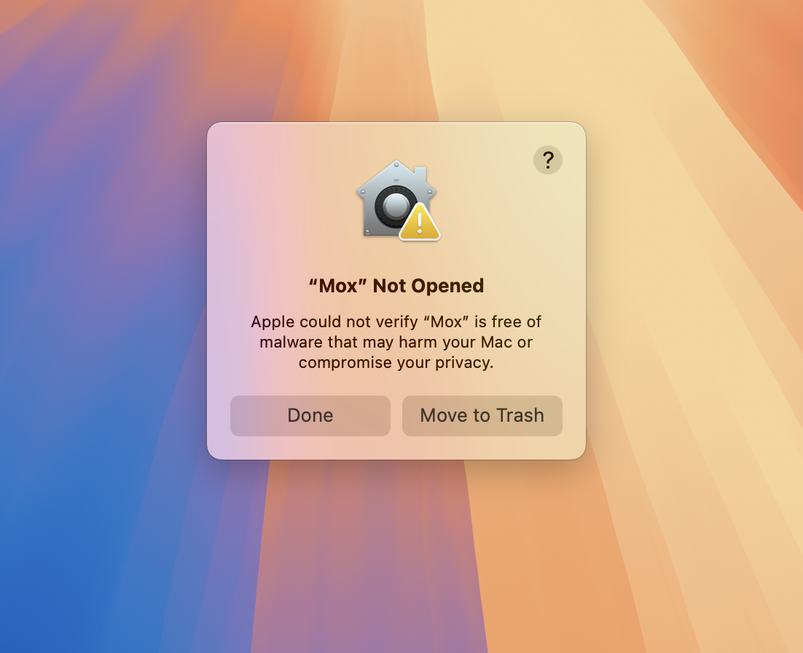
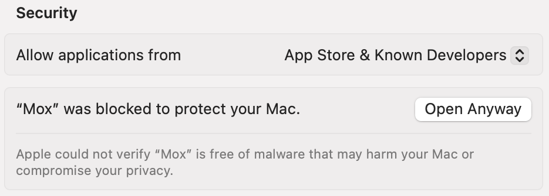
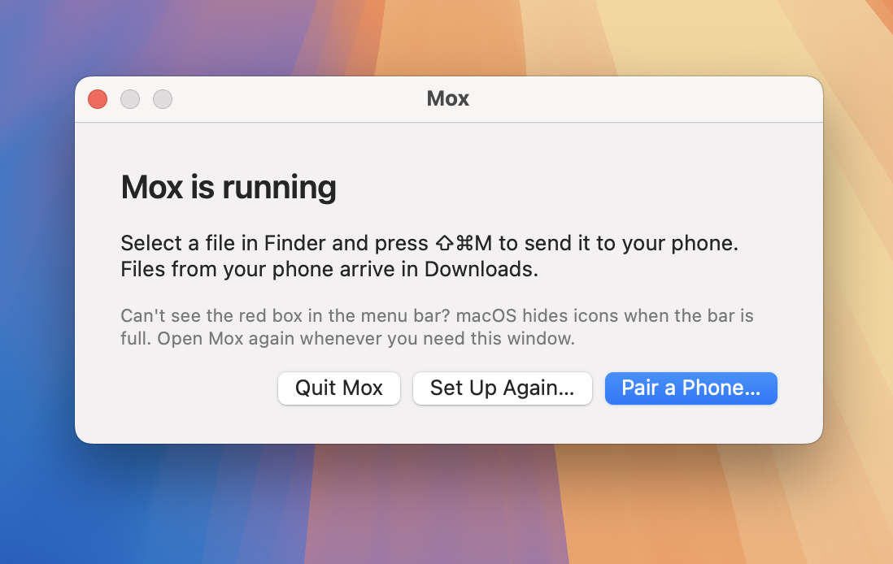
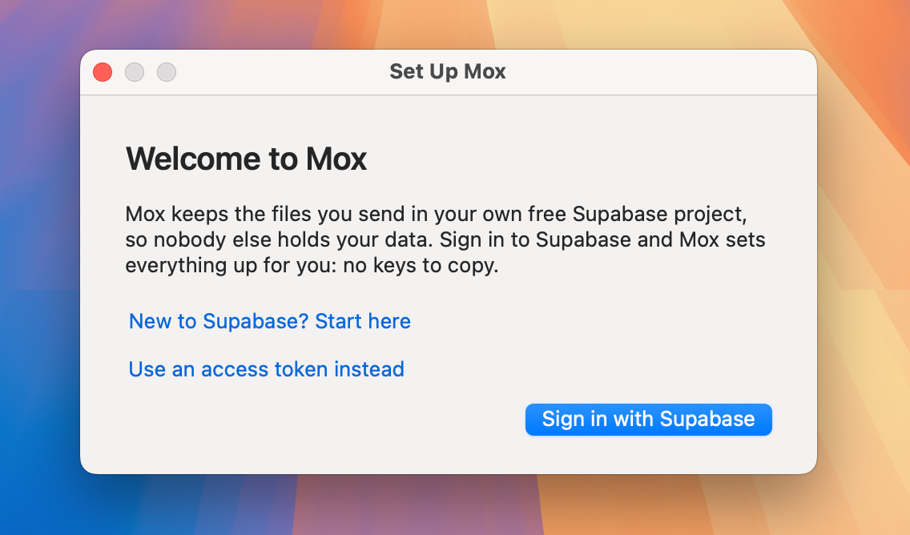
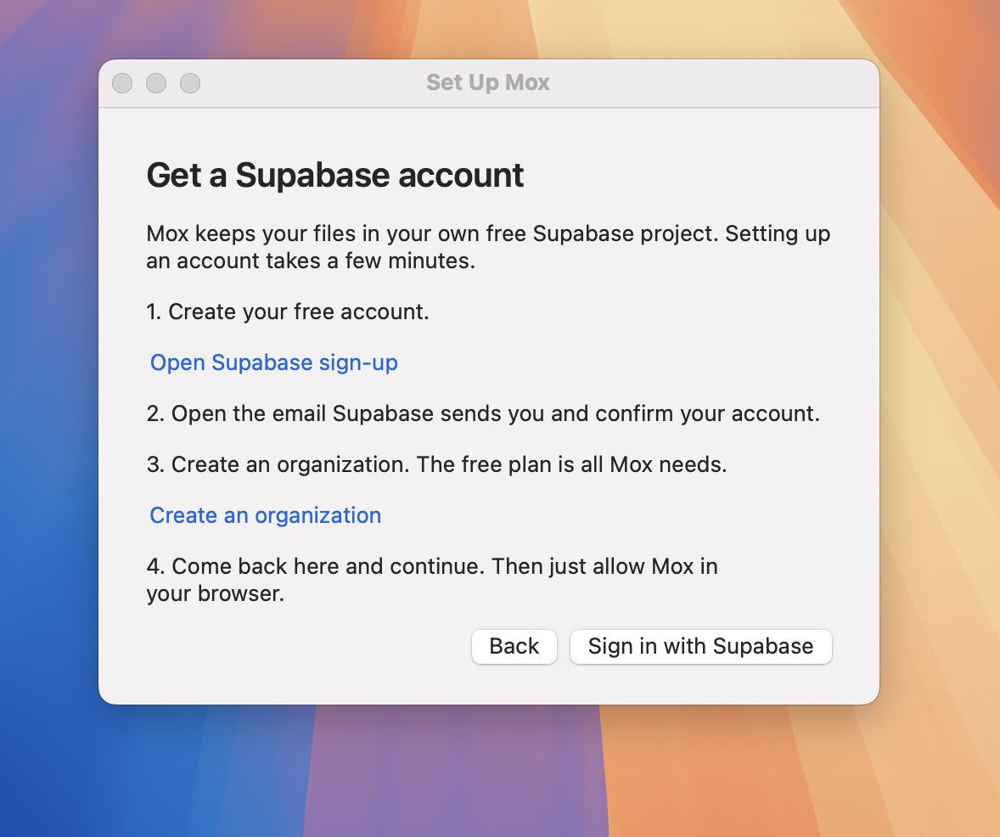
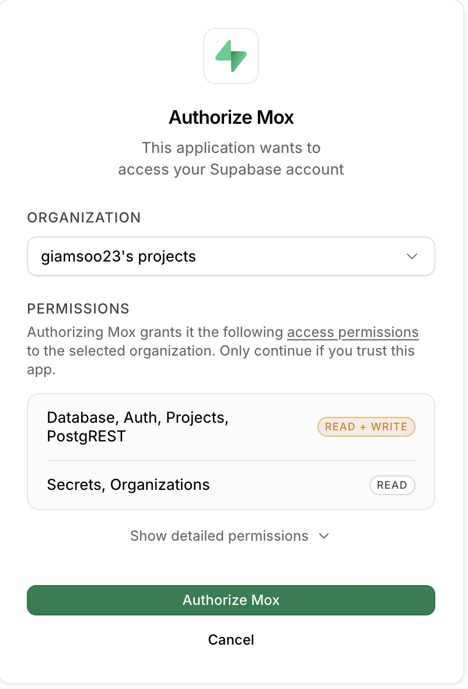
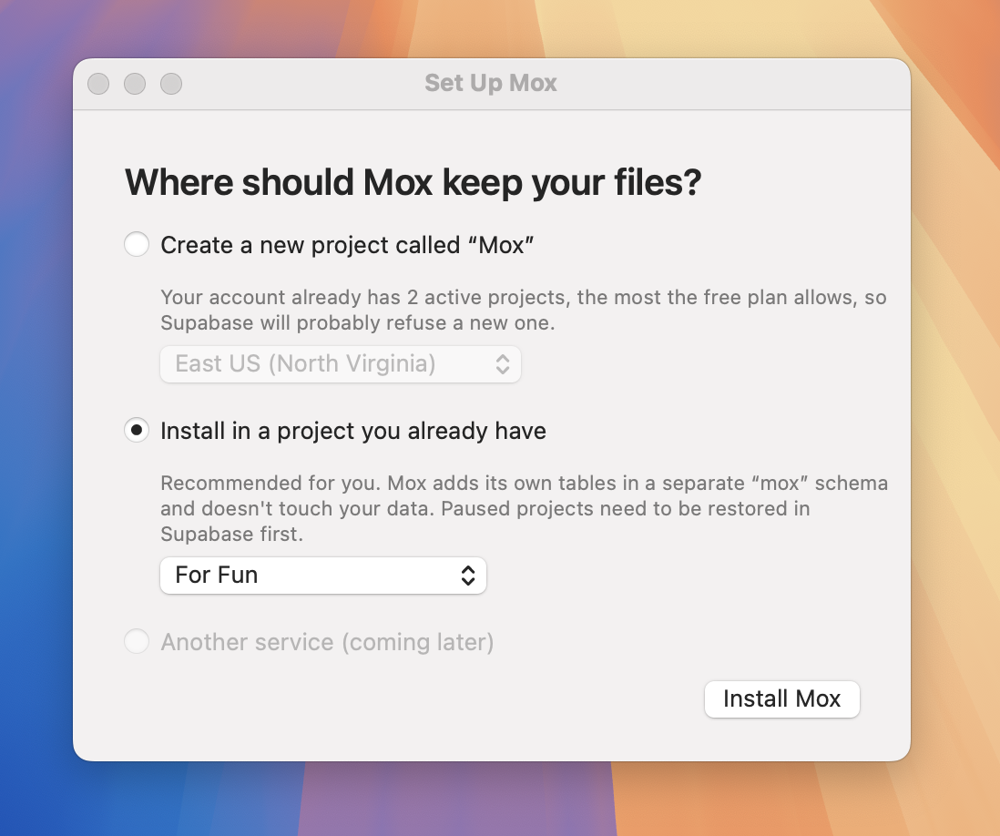
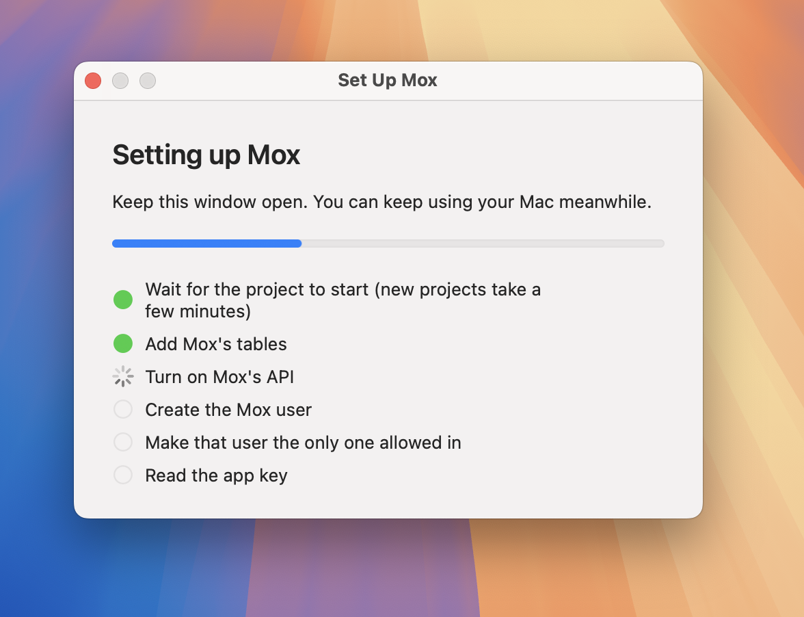
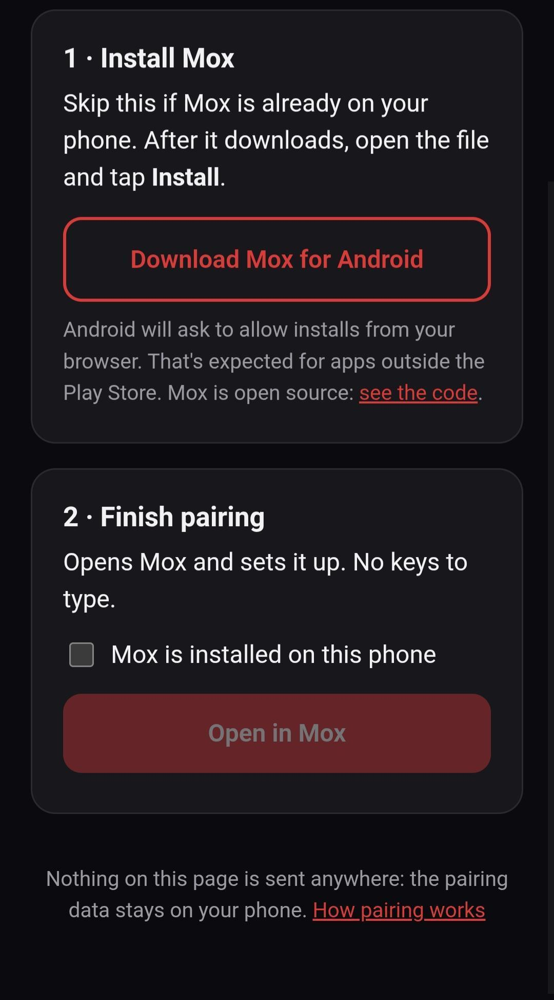
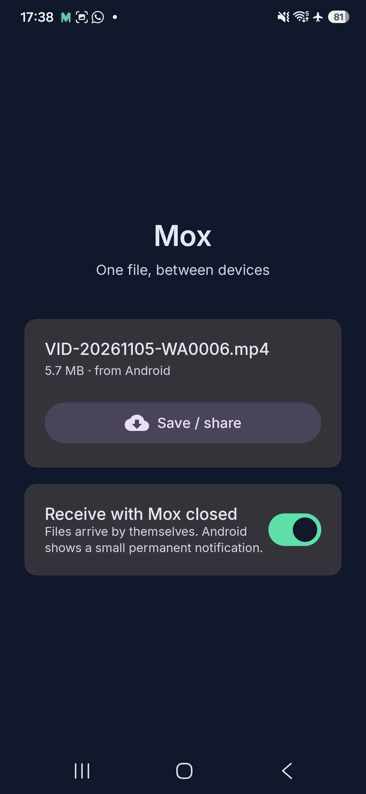

# Installing Mox

About ten minutes, most of it waiting for Supabase. You need:

- a computer: a **Mac** with macOS 13 or later, or a **Windows** PC,
- a phone: an **Android** phone with Android 8 or later, or an **iPhone**,
- a free [Supabase](https://supabase.com) account. Mox keeps your files in
  **your own** Supabase project, so nobody else holds them. If you don't have
  an account, you can create one during setup.

## 1. Install Mox on the computer

**On Windows,** skip to [Windows](#on-windows) below. The rest of this
section is for the Mac.

1. Download **Mox-macOS.zip** from the
   [latest release](https://github.com/GiamSoo23/Mox/releases/latest) and
   double-click it.
2. Open **Mox.app**.
3. macOS warns that it can't check the app for malicious software, because
   Mox isn't notarized by Apple yet. To open it anyway:
   - **macOS 15 or later:** click **Done**, open **System Settings → Privacy &
     Security**, scroll down to "Mox was blocked", and click **Open Anyway**.
   - **macOS 13–14:** right-click Mox.app, choose **Open**, then **Open** again.

   

   

   You only do this once. To check the download first, compare it with
   `SHA256SUMS.txt` from the same release: `shasum -a 256 Mox-macOS.zip`.

When it opens, Mox offers to **move itself to Applications**. Accept, and it
reopens from there.

Mox lives in the menu bar (a red box icon). macOS hides menu bar icons when
the bar is full, and no app can claim a spot. If you can't see it, open Mox
again from Applications: a window appears with **Pair a Phone…**, **Set Up
Again…** and **Quit**, and Mox stays in the Dock until you quit it.



## 2. Set it up

The setup window opens on the first launch. You can also open it from the
menu bar: **Set Up Mox…**



**No Supabase account yet?** Click **New to Supabase? Start here**. You'll
create a free account, confirm it from the email Supabase sends, and create
an organization. Then come back and sign in.



1. Click **Sign in with Supabase**. Your browser opens. Sign in, choose your
   organization, and allow Mox. Then go back to Mox.

   Mox uses this sign-in only to set up your project. It doesn't keep it.

   
2. Choose where Mox keeps your files:
   - **Create a new project** (recommended). Supabase takes a few minutes to
     start it.
   - **A project you already have.** Mox adds its own tables in a separate
     `mox` schema and doesn't touch your data.

   
3. Wait for the checklist to finish. Mox then shows a QR code.

   

### If you already have two free projects

Supabase's free plan allows two active projects. When you're at the limit,
Mox recommends installing into one of them. You can also pause a project
you don't use in the [Supabase dashboard](https://supabase.com/dashboard).
Pausing keeps its data, and you can restore it later.

A paused project shows as "(paused)" and can't be chosen. Restore it in the
dashboard first, then reopen **Set Up Mox…**.

### If other people manage the project

Mox warns you when other accounts administer the Supabase organization.
Those people could see the files you send. Choose a project only you manage
if that matters to you.

### Signing in without the browser

If **Sign in with Supabase** isn't there (an app you built yourself), or
doesn't work, use **Use an access token instead**:

1. Create a token at
   [supabase.com/dashboard/account/tokens](https://supabase.com/dashboard/account/tokens).
2. Paste it into Mox. It's used only for this setup and isn't saved.
3. Delete the token afterwards if you like.

### On Windows

1. Download **Mox for Windows (most PCs)** from the
   [latest release](https://github.com/GiamSoo23/Mox/releases/latest).
   Choose **(ARM)** only for ARM PCs, such as Windows on a Mac with Apple
   silicon. **Settings → System → About → System type** tells you which.
2. Open **Mox-Windows-x64.exe**. Windows warns that it's an unrecognized app,
   because Mox isn't signed yet: click **More info → Run anyway**.
3. The setup window opens: **Sign in** with Supabase, choose a project, and
   wait for the progress bar. A QR code appears at the end.

Mox lives in the notification area, at the bottom right (maybe under the
**^** arrow). It starts with Windows; turn that off in its menu with **Start
with Windows**.

## 3. Pair your phone

When the checklist finishes, Mox shows a QR code. Take your phone and scan it
with the camera.

Each QR code is unique to your project. There's no picture of one here because
Mox blocks screenshots of that window for security: the code contains your Mox
password.

The code opens a page on your phone that gets Mox installed and paired:



1. Tap **Download Mox for Android**. When it finishes, open the file and tap
   **Install**. Android asks you to allow installs from your browser the first
   time. Skip this if Mox is already on your phone.
2. Go back to the page, check **Mox is installed on this phone**, and tap
   **Open in Mox**.
3. Mox opens and says **Paired with** your Mac's name. It's ready to use.

   

### On an iPhone

The QR code opens a page that sets up **Mox for iPhone**, an app on your home
screen. Nothing to install from the App Store.

1. Tap **Set up Mox for iPhone**, then **Copy pairing code**.
2. Tap the **Share** button and choose **Add to Home Screen**.
3. Open **Mox** from your home screen and tap **Paste pairing code**.
4. Follow its three steps: turn on notifications, add the **Send to Mox**
   shortcut, and connect it (paste the setup code and run it until it says
   **Mox is ready**).

To send from Photos or Files, tap **Share → Send to Mox** at the bottom of
the list. To send something you copied, open Mox and tap **What I copied**.
When something arrives, tap the notification: texts and photos are copied
right away.

The QR code contains Mox's password for your project, so don't share it or
send a screenshot of it. To pair another phone later, choose **Pair a
Phone…** in the menu bar.

## 4. Use it

| From | How |
|---|---|
| **Mac** | Select a file in Finder and press **⌘⇧M**. To send copied text, press **⌃⇧M** |
| **Windows** | Select a file in Explorer and press **Ctrl+Shift+M**. Anywhere else, the same keys send what you copied: text, a file or an image |
| **Android** | In any app, tap **Share → Mox**, for files and text |
| **iPhone** | **Share → Send to Mox**, or **What I copied** in Mox |

Files land in Downloads (photos and videos in the gallery on Android), and
files, images and texts go on the clipboard.

### Receiving with Mox closed

Once paired, Android shows a small permanent **Mox is listening** notification,
and files arrive by themselves. To turn that off, use the switch on Mox's main
screen. If the screen says Android may stop Mox, tap **Allow in the
background**. On Samsung phones, also open **Settings → Battery → Background usage
limits** and add Mox to the apps that never sleep.

## Uninstalling

- **Android:** uninstall Mox like any other app.
- **iPhone:** remove Mox and the Send to Mox shortcut from the home screen
  and the Shortcuts app.
- **Windows:** choose **Quit Mox** in its menu, delete **Mox-Windows-x64.exe**,
  and delete the folder `%APPDATA%\Mox`.
- **Mac:** choose **Quit Mox**, delete Mox from Applications, then remove its
  saved settings in the Terminal:
  ```
  security delete-generic-password -s com.mox.app.settings -a default
  defaults delete com.mox.app
  ```
- **Your data:** Mox's files are in your Supabase project. If you created one
  just for Mox, delete it from the [dashboard](https://supabase.com/dashboard).
  In a project you share with another app, Mox's data is the `mox` schema, the
  `mox` Storage bucket and the `mox-…@mox.invalid` user.

## Something went wrong

| What you see | What to do |
|---|---|
| "Another app is using port 53682" | Quit the app using it, or use an access token instead |
| "Your account already has the maximum number of free projects" | Choose a project you already have, or pause one (see above) |
| "This project is paused" | Restore it in the Supabase dashboard, then try again |
| "Mox is already set up in this project" | **Set Up Again** creates a new Mox user. Your paired devices then need to pair again |
| The phone says it can't sign in | Pair again from **Pair a Phone…** on the Mac |

Still stuck? [Open an issue](https://github.com/GiamSoo23/Mox/issues/new).
