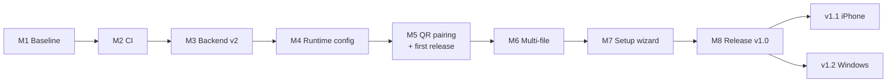

# Mox v2: roadmap

**Last updated:** 2026-11-07 · **Design:** [DESIGN.md](DESIGN.md)

This is the delivery plan for the v2 design: what gets built, in what order,
and how it's split into pull requests and commits. Every commit listed here
is real work still to do. The plan exists so the history comes out in small
steps that are easy to review, not to make the history look like something
it isn't.

> **Priority: Mac ↔ Android comes first.** That pair already exists and
> works. Everything up to `v1.0.0` touches only the macOS app, the Android
> app, the backend, the shared protocol, CI and docs. iPhone (v1.1) and
> Windows (v1.2) start only after v1.0 ships.

## At a glance

| | v1.0: open source, Mac ↔ Android | v1.1: iPhone | v1.2: Windows | **Total** |
|---|:-:|:-:|:-:|:-:|
| Milestones | 8 | 1 | 1 | **10** |
| Pull requests | 26 | 2 | 5 | **33** |
| Commits | 66 | 6 | 13 | **85** |

**Submission line for MLH: v1.0.** At that point the repo has tests on
every layer, CI on every PR, automated releases (since M5), a deployed pairing page,
multi-file sending, and keys that are no longer in the code. v1.1 and v1.2
can stay as open milestones with issues already written, which shows the
roadmap.

### Work areas

| Area | Label | Commits | Language / tools |
|---|---|:-:|---|
| macOS | `area:macos` | 18 | Swift, AppKit, XCTest |
| Android | `area:android` | 13 | Kotlin, Compose, JUnit |
| CI/CD and quality | `area:ci` | 13 | GitHub Actions, Docker, linters, contract tests |
| Docs and repo | `area:docs` | 12 | Markdown, Mermaid |
| Windows | `area:windows` | 11 | C#, .NET 8, xUnit |
| Backend | `area:backend` | 8 | SQL, Supabase CLI, pgTAP |
| iPhone | `area:ios` | 4 | Apple Shortcuts |
| Shared protocol | `area:shared` | 4 | Markdown, JSON fixtures |
| Pairing page | `area:web` | 2 | HTML, CSS, JS |
| **Total** | | **85** | |

---

## How we work (GitHub flow)

- **One issue per PR.** The issue says *what* and *why*, and the PR closes it
  (`Closes #12`). Every row in the tables below links to its issue. New
  problems get an issue before any work starts.
- **Branches** are named `area/short-topic`, for example `android/runtime-config`.
- **Conventional commits:** `feat(macos): …`, `fix(backend): …`, `test: …`,
  `ci: …`, `docs: …`, `refactor: …`, `chore: …`.
- **Milestones** are the versions below. **Labels** are the areas above.
- **Merge with "Rebase and merge"** (or a merge commit), **not squash**.
  Squashing turns each PR into one commit and hides the steps.
- From milestone 2 onward, **every PR has to pass CI** before it's merged.
- Each finished milestone gets a tag: M1 = `v0.1.0`, M2 = `v0.2.0` … M8 = `v1.0.0`.

---

## v1.0: open source, Mac ↔ Android

### Milestone 1: Baseline and open-source groundwork · size S

Get the work that isn't committed yet into history, and prepare the repo to
be public.

| Issue | Branch | Commits |
|---|---|---|
| [#1](https://github.com/GiamSoo23/Mox/issues/1) | `chore/pending-features` | `feat(android): copy incoming files to clipboard via notification trampoline` · `feat(macos): auto-save phone files to Downloads and copy to pasteboard` · `feat(macos): launch at login via SMAppService` · `chore(macos): add app icon to bundle` |
| [#2](https://github.com/GiamSoo23/Mox/issues/2) | `docs/architecture` | `docs: rewrite README with architecture diagrams` · `docs: add ARCHITECTURE.md` · `docs: fix outdated hotkey in macOS README` · `docs: add v2 design and roadmap` |
| [#3](https://github.com/GiamSoo23/Mox/issues/3) | `chore/open-source` | `chore: add MIT license` · `chore: add .editorconfig and tidy .gitignore` · `refactor: restructure repo into backend/desktop/mobile/shared` |

**11 commits.** Before the repo is made public: rotate the Supabase key in
the dashboard (it's in the git history) and make sure M4 is merged.

### Milestone 2: Quality gates and CI · size S

CI comes early so that every later PR shows a green check.

| Issue | Branch | Commits |
|---|---|---|
| [#4](https://github.com/GiamSoo23/Mox/issues/4) | `chore/linters` | `chore(macos): add SwiftLint config and fix warnings` · `chore(android): add ktlint and format sources` |
| [#5](https://github.com/GiamSoo23/Mox/issues/5) | `ci/build` | `ci: build and lint macOS app` · `ci: build and lint Android app` |

**4 commits.**

### Milestone 3: Backend v2 · size M

| Issue | Branch | Commits |
|---|---|---|
| [#6](https://github.com/GiamSoo23/Mox/issues/6) | `backend/supabase-cli` | `chore(backend): initialize Supabase CLI project` · `refactor(backend): move schema.sql into first migration` |
| [#7](https://github.com/GiamSoo23/Mox/issues/7) | `backend/schema-v2` | `feat(backend): replace uploaded_from with source platform and device id` · `fix(backend): store file under fixed key to stop orphaned objects` · `feat(backend): lower file size limit to 50 MB` · `feat(backend): add kind and item_count for multi-file bundles` · `feat(backend): add mox_meta with schema version` · `test(backend): pgTAP tests for singleton, checks and policies` |
| [#8](https://github.com/GiamSoo23/Mox/issues/8) | `shared/protocol` | `docs(shared): write protocol spec for all clients` · `test(shared): add JSON fixtures for rows` |
| [#9](https://github.com/GiamSoo23/Mox/issues/9) | `ci/backend` | `ci: run database tests against Supabase in Docker` |

**11 commits.** This is where Docker first shows up. The bundle columns go
in now so the multi-file milestone doesn't need another migration.

### Milestone 4: Runtime config and security · size L

Both existing apps move to schema v2 and publishable keys, and there are no
more credentials in the code.

| Issue | Branch | Commits |
|---|---|---|
| [#10](https://github.com/GiamSoo23/Mox/issues/10) | `macos/core-module` | `refactor(macos): extract MoxCore library target` · `test(macos): unit tests for hotkey parsing, config and MIME mapping` |
| [#11](https://github.com/GiamSoo23/Mox/issues/11) | `macos/keychain-config` | `feat(macos): store project URL and key in Keychain` · `refactor(macos): rename anon key to publishable key` · `feat(macos): adopt schema v2` |
| [#12](https://github.com/GiamSoo23/Mox/issues/12) | `android/runtime-config` | `refactor(android): introduce MoxBackend interface` · `feat(android): encrypted runtime config store` · `feat(android): remove hard-coded credentials and add "not paired" screen` · `feat(android): adopt schema v2` · `test(android): unit tests against shared fixtures` |
| [#13](https://github.com/GiamSoo23/Mox/issues/13) | `test/contract` | `test: contract tests against local Supabase` · `ci: run contract tests in Docker` |

**12 commits.**

### Milestone 5: QR pairing and first release (Mac → Android) · size M

| Issue | Branch | Commits |
|---|---|---|
| [#14](https://github.com/GiamSoo23/Mox/issues/14) | `shared/pairing-spec` | `docs(shared): pairing payload v1 spec and fixtures` |
| [#15](https://github.com/GiamSoo23/Mox/issues/15) | `macos/pairing` | `feat(macos): pairing payload encoder` · `feat(macos): "Pair a phone" window with QR code` · `test(macos): payload round-trip against fixtures` |
| [#16](https://github.com/GiamSoo23/Mox/issues/16) | `web/pair-page` | `feat(web): static pairing page with OS detection` · `ci(web): deploy pairing page to GitHub Pages` |
| [#17](https://github.com/GiamSoo23/Mox/issues/17) | `android/pairing` | `feat(android): handle mox://pair deep link` · `feat(android): manual pairing fallback` · `test(android): payload parsing against fixtures` |
| [#24](https://github.com/GiamSoo23/Mox/issues/24) | `cd/release` | `ci: release workflow builds APK and Mox.app on tag` · `ci: attach checksums and release notes` |

**11 commits.** At the end of M5 you can scan the Mac's QR with a phone,
download the APK and pair, all without touching any keys. Tag `v0.5.0` as the
first pre-release.

- The release workflow (#24) was moved here from M8 so the APK exists for
  the QR to point to.
- **The repo has to be public by now**, because assets from private repos
  can't be downloaded without a GitHub login. Before making it public:
  #12 merged, the old key rotated (#36), gitleaks clean.
- The pairing page is the project's "deploy". In v1.0 it only hands off to
  Android. The iPhone hand-off arrives in v1.1.

### Milestone 6: Multi-file bundles · size M

Send several files (or a folder) at once. The sender packs them into an
uncompressed zip marked `kind = bundle`, and the receiver unpacks it so you
see the original files. See DESIGN.md §9.

| Issue | Branch | Commits |
|---|---|---|
| [#18](https://github.com/GiamSoo23/Mox/issues/18) | `shared/bundle-spec` | `docs(shared): bundle format spec and fixtures` |
| [#19](https://github.com/GiamSoo23/Mox/issues/19) | `macos/bundles` | `feat(macos): send multiple Finder items and folders as a bundle` · `feat(macos): extract received bundles into a Downloads folder and copy all files` · `test(macos): bundle round-trip, zip-slip and size-limit tests` |
| [#20](https://github.com/GiamSoo23/Mox/issues/20) | `android/bundles` | `feat(android): share multiple files as a bundle` · `feat(android): save received photos and videos to the gallery` · `feat(android): extract received bundles` · `test(android): bundle round-trip, zip-slip and size-limit tests` |
| [#21](https://github.com/GiamSoo23/Mox/issues/21) | `docs/bundles` | `docs: document multi-file sending` |

**9 commits.** Good material for the demo video: 5 photos selected in Finder
show up as 5 photos in the phone's gallery.

### Milestone 7: Setup wizard · size M

Start with the spikes for risks #2 and #3 in DESIGN.md: try the scoped
token and running migrations through the API. They're experiments, not
commits.

| Issue | Branch | Commits |
|---|---|---|
| [#22](https://github.com/GiamSoo23/Mox/issues/22) | `macos/setup-wizard` | `feat(macos): Supabase Management API client` · `feat(macos): onboarding window (existing project or create new)` · `feat(macos): provision project and apply migrations` · `test(macos): provisioning flow with mocked URLProtocol` |
| [#23](https://github.com/GiamSoo23/Mox/issues/23) | `docs/self-hosting` | `docs: self-hosting and install guide` |

**5 commits.**

### Milestone 8: Release v1.0 · size S

| Issue | Branch | Commits |
|---|---|---|
| [#25](https://github.com/GiamSoo23/Mox/issues/25) | `docs/v1` | `docs: README for users and contributors` · `docs: update ARCHITECTURE for v2` |
| [#26](https://github.com/GiamSoo23/Mox/issues/26) | `docs/community` | `docs: CONTRIBUTING, SECURITY and issue templates` |

**3 commits**, then the `v1.0.0` tag. The release workflow has existed
since M5, so the tag alone publishes v1.0. Record the demo video and
screenshots here (they go into the README through GitHub's editor).

> **v1.0 total: 26 PRs · 66 commits** (11 + 4 + 11 + 12 + 11 + 9 + 5 + 3).

---

## v1.1: iPhone (Shortcuts) · size M

Before starting, try risk #4 (50 MB uploads from Shortcuts) and the ntfy
notification experiment (risk #8). Neither is a commit.

| Issue | Branch | Commits |
|---|---|---|
| [#27](https://github.com/GiamSoo23/Mox/issues/27) | `ios/shortcuts` | `feat(ios): "Send to Mox" share-sheet shortcut, multi-file aware` · `feat(ios): "Get from Mox" shortcut with bundle extraction` · `feat(ios): "Mox Setup" shortcut and pairing hand-off` · `docs(ios): install guide and limitations` |
| [#28](https://github.com/GiamSoo23/Mox/issues/28) | `ci/ios-release` | `feat(web): pairing page hands off to Shortcuts on iOS` · `ci: sign shortcuts and attach to releases` |

**6 commits.**

## v1.2: Windows · size L

| Issue | Branch | Commits |
|---|---|---|
| [#29](https://github.com/GiamSoo23/Mox/issues/29) | `windows/scaffold` | `chore(windows): scaffold .NET 8 tray app solution` · `ci: build and test Windows app` |
| [#30](https://github.com/GiamSoo23/Mox/issues/30) | `windows/core` | `feat(windows): Supabase client following the protocol` · `test(windows): xUnit tests against shared fixtures` · `feat(windows): tray menu, polling and toast notifications` |
| [#31](https://github.com/GiamSoo23/Mox/issues/31) | `windows/send` | `feat(windows): global hotkey` · `feat(windows): read Explorer selection` · `feat(windows): "Send to → Mox" and mox send command` |
| [#32](https://github.com/GiamSoo23/Mox/issues/32) | `windows/receive` | `feat(windows): auto-save to Downloads, copy to clipboard and run at login` · `feat(windows): send and extract bundles` |
| [#33](https://github.com/GiamSoo23/Mox/issues/33) | `windows/pairing-setup` | `feat(windows): protected config store and pairing QR` · `feat(windows): setup wizard` · `ci: add Windows build to release workflow` |

**13 commits.** You need a Windows PC or VM for manual testing (risk #1).

---

## Order and dependencies

v1.1 and v1.2 are independent of each other. iPhone comes first because it's
smaller, and because the author uses an iPhone now. M6 only depends on M4,
so if pairing gets stuck, multi-file can go first.

## If time runs short

The smallest version that still holds up for MLH: **M1 → M2 → M3 → M4 → the
README part of M8.** That's about 40 commits and covers keys out of the code,
tests, CI with Docker, and documentation. Pairing, multi-file, the wizard,
iPhone and Windows stay as open issues inside their milestones.
